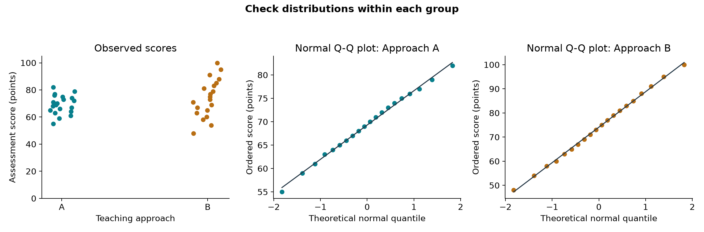

# Checking Data and Assumptions

::: {.cdi-message}
- **ID:** STATS-003
- **Type:** Reference guide
- **Audience:** Beginner to intermediate learners, researchers, and analysts
- **Theme:** Inspect inputs, study design, and diagnostic plots before trusting statistical results or AI suggestions
:::

A test can run successfully on unsuitable data. Before calculating a p-value, check what each row represents, whether values make sense, and whether the proposed method matches the design.

This chapter uses synthetic assessment scores to demonstrate a basic checking workflow. It prepares you for the method chapters; it does not perform the final group comparison.

## 1. Your question and inputs

> How do mean assessment scores differ between two teaching approaches?

For this illustration, assume different learners contribute one score each and there is no classroom clustering. In an applied study, verify those facts from the study records.

| Field | Meaning | Expected values |
|---|---|---|
| `learner_id` | Unique learner identifier | One nonmissing ID per learner |
| `approach` | Teaching approach | A or B |
| `score` | Assessment score in points | 0 to 100; blank if unavailable |

There are 42 synthetic learners, 21 per approach. Each group contains 20 observed scores and one missing score. These data are separate from the summary-statistic illustration in Chapter 02.

## 2. Check the table before the test

| Check | What to investigate | Possible action |
|---|---|---|
| Row meaning | One learner, visit, plot, or measurement? | Document the unit and expected number of rows |
| Identifiers | Missing IDs, duplicates, unexpected repeated units | Reconcile with source records |
| Variable types | Scores imported as text; codes treated as measurements | Correct parsing and document category meanings |
| Units and ranges | Mixed units, impossible scores, sentinel values such as -999 | Verify against the data dictionary |
| Categories | A, a, and “Approach A” used inconsistently | Standardize verified labels |
| Missing values | Blanks, NA codes, and missingness by group | Count and investigate reasons |
| Joins | Duplicated rows or unmatched records after merging | Check keys and row counts before and after joining |

Do not automatically delete duplicate-looking records. They may be legitimate repeated observations. Determine whether the duplication is an error or a design feature.

Preserve the original input. Record corrections in code or a change log rather than silently overwriting source values.

## 3. Check missing data

Report both the number of available values and the number missing for each relevant group or variable.

| Approach | Total learners | Observed scores | Missing scores |
|---|---:|---:|---:|
| A | 21 | 20 | 1 |
| B | 21 | 20 | 1 |

Equal missing counts do not establish that missingness is harmless. For example, missing scores could come from learners who found the assessment especially difficult.

Ask why the values are missing, whether missingness relates to the outcome or predictors, and how excluding records changes the population represented by the analysis.

Do not replace missing scores with zero. Zero is a real score on this scale. Simple mean imputation also changes variability and can distort uncertainty. Select a missing-data approach appropriate to the question and plausible missingness process, and state its assumptions.

Here, the plots and summaries use observed scores only. This is a description of available data, not a justification for excluding missing scores from every subsequent inference.

## 4. Check independence and pairing

Independence is supported by the sampling and measurement process, not established by a normality test.

- Different independently sampled learners with one score each may support an independent comparison.
- Before-and-after measurements on the same learners require a paired or repeated-measures approach.
- Learners within classrooms may share conditions and have correlated outcomes.
- Multiple measurements from one plant or participant are not automatically separate independent replicates.

If the design does not fit a simple independent test, address that before interpreting its output. A transformation or rank-based test does not remove dependence.

## 5. Inspect plots within groups

{#fig-score-diagnostics width=100%}

The left panel shows individual observations. Approach B has a wider spread. The horizontal positions within each group are visual offsets and do not encode learner order or another variable.

The Q-Q panels compare ordered scores with theoretical normal quantiles. Points approximately following a straight line are consistent with a roughly normal shape; systematic curves or large departures may indicate skewness, heavy tails, or unusual observations. Small samples provide limited information about distribution shape.

The synthetic points lie fairly close to their reference lines. This does not prove normality or validate the study design. The Q-Q panels have different vertical scales: compare shape there and use the left panel and SDs to compare spread.

### Which distribution matters?

| Proposed analysis | Relevant diagnostic target |
|---|---|
| One-sample t-test | Distribution of the numerical outcome |
| Independent-samples t-test | Distribution within each group |
| Paired t-test | Distribution of within-pair differences |
| Linear regression | Model residuals and their relationship to fitted values and predictors |

For example, pooling two groups with different means can produce a misleading shape. For a paired test, examining the before and after distributions separately does not replace checking the differences.

## 6. Understand assumptions in context

### Normality

Normal-theory procedures may require approximately normal errors or observations for exact small-sample inference. Some mean-based procedures tolerate moderate departures under suitable conditions, but performance depends on sample size, balance, tail behavior, and influential observations.

Do not use a normality-test p-value as an automatic switch between tests. A small sample may fail to reveal an important departure; a large sample may detect a small departure with little practical consequence. Combine plots, design knowledge, and method-specific reasoning.

### Variability

The observed SDs are approximately 6.97 points in A and 13.96 points in B. Equal sample sizes do not imply equal population variances. Welch's independent-samples t-test accommodates unequal variances; it still requires an appropriate design and attention to distribution shape and influential observations.

### Unusual values

A score of 100 may be valid. A score of 1000 is outside the stated scale and needs investigation. Being unusual does not by itself justify removal.

Verify source records, distinguish errors from valid extremes, and document any exclusion rule. If a valid value strongly affects the conclusion, consider a clearly described sensitivity analysis. Do not remove observations to obtain significance.

### Relationships and residuals

Correlation and regression require additional checks. A scatterplot may reveal curvature, subgroups, or a single influential observation. Regression diagnostics may reveal nonlinearity, changing residual spread, or dependence over time. The relevant chapters develop these checks.

## 7. Reproduce the example

Download the companion files with this chapter and copy their folders into the book repository root. The script creates the fixed synthetic dataset, reads it back, checks IDs and score ranges, and writes summaries and the diagnostic figure.

**Files:** [Python script](scripts/python/03-check-data.py), [synthetic input](data/example/training-scores.csv), and [summary table](results/tables/training-score-checks.csv).

Use your activated project environment with NumPy, SciPy, and Matplotlib installed. From the repository root, run:

```bash
python scripts/python/03-check-data.py
```

The script overwrites its teaching dataset and outputs at the listed paths. Use a separate script and input path for your own data.

**Expected summary:**

| Approach | Observed scores | Mean | Sample SD |
|---|---:|---:|---:|
| A | 20 | 69.30 | 6.97 |
| B | 20 | 74.10 | 13.96 |

The script checks file structure and selected value rules. It cannot establish independence, explain missingness, or verify how participants were assigned.

## 8. Use AI and check its suggestions

### Example prompt

> I have scores from 42 learners, with 21 assigned to each of two approaches. One score is missing in each group. Observed-score SDs are about 7 and 14 points. Help me plan checks before comparing means. Ask about independent units, classroom clustering, assignment, missingness, and unusual observations. Explain what to look for in group plots and Q-Q plots. Do not automatically choose a rank test based on a normality-test p-value or remove unusual observations.

### Assess the response

| AI suggestion | Your check |
|---|---|
| “The IDs are unique, so observations are independent.” | Unique IDs do not rule out classroom clustering or other dependence |
| “There is little missing data, so it cannot matter.” | Assess reasons and possible outcome-related missingness |
| “Remove the highest score.” | Verify whether it is an error and document a defensible rule |
| “The Q-Q plots look straight, so all assumptions hold.” | Plots address distribution shape, not every assumption |
| “The SDs differ, so a comparison of means is impossible.” | Consider a suitable method such as Welch's test and the remaining conditions |

## 9. Record your findings before analysis

For this example:

> The synthetic dataset contains 42 unique learner records across two approaches. Each approach has 20 observed scores and one missing score. All observed scores fall between 0 and 100. Mean scores are 69.30 and 74.10 points, with SDs of 6.97 and 13.96. The group plots show greater spread in B; the Q-Q plots show no large departures from their reference lines. An independent mean comparison would require verification of the sampling and assignment process, absence of unaccounted clustering, and a justified approach to the missing scores. Unequal variability supports considering Welch's method rather than assuming equal variances.

This note describes readiness and unresolved issues. It does not conclude that either approach is better.

## 10. Check your understanding

A dataset contains 30 learners measured before and after training. An AI response recommends treating the 60 scores as independent because all scores fall within the permitted range.

What should you correct before running the analysis?

::: {.callout-note collapse="true"}
## Check your reasoning
The measurements are paired by learner. There are 30 learners, each contributing two dependent measurements. Verify the IDs and pairing, calculate within-learner differences, investigate missing pairs, and examine those differences if considering a paired t-test. Valid score ranges do not establish independence. A before-and-after difference alone also does not establish a treatment effect.
:::

## Next step

Continue to [One-Sample t-Test](04-one-sample-t-test.qmd) for a mean comparison with a reference value, or [Independent-Samples t-Test](05-independent-t-test.qmd) for two independent groups.
