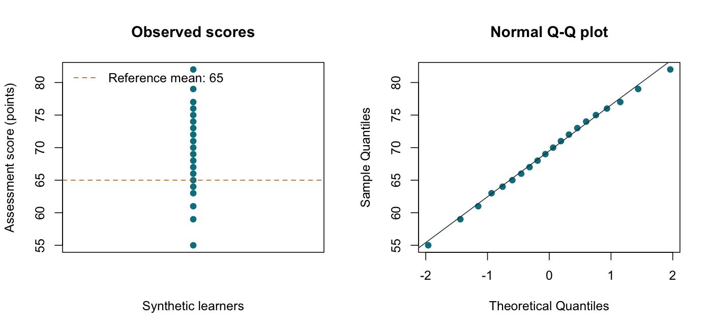

# One-Sample t-Test

::: {.cdi-message}
- **ID:** STATS-004
- **Type:** Statistical method reference
- **Audience:** Beginner to intermediate learners, researchers, and analysts
- **Theme:** Compare a population mean with a fixed reference value, check assumptions, and explain the estimate and uncertainty
:::

## 1. Your question

> Does the population mean assessment score differ from a prespecified reference of 65 points?

We use 20 synthetic learner scores. The target estimate is the **population mean minus 65**, measured in score points. Positive values indicate a mean above the reference.

The reference is an illustrative fixed benchmark chosen before analysis. It is not a universal passing standard. The data reuse the 20 observed Approach A scores from Chapter 03 as a standalone teaching example; this does not justify ignoring that chapter's missing scores in an applied analysis.

## 2. When to use this method

Use a one-sample t-test when you have a numerical outcome from independent units and want to compare its population mean with a fixed reference.

| Suitable question | Example |
|---|---|
| Does a mean differ from a benchmark? | Mean assessment score versus 65 points |
| Does a mean measurement differ from a specification? | Mean package weight versus 500 grams |
| Is a mean difference zero? | Paired differences analyzed as one numerical sample; see Chapter 06 |

If the reference is an estimate from another sample, treating it as fixed ignores its uncertainty. A two-sample comparison or another model may be appropriate. If your question concerns a proportion or a median, this test does not directly answer it.

## 3. What it estimates or tests

Let $\mu$ denote the population mean and $\mu_0=65$ the fixed reference.

- **Null hypothesis:** $H_0: \mu=65$.
- **Two-sided alternative:** $H_1: \mu\ne65$.
- **Estimated difference:** $\bar{x}-65$.

The test statistic expresses the difference in estimated standard errors:

$$
t = \frac{\bar{x}-\mu_0}{s/\sqrt{n}}, \qquad df=n-1.
$$

For independent observations from a normal population, this statistic follows a t distribution under the null. Under other distributions, the accuracy of the approximation depends on sample size, shape, and tail behavior.

A two-sided test allows departures in either direction. Specify a one-sided alternative only when justified before looking at the scores.

## 4. Check your data and assumptions

| Check | What to establish |
|---|---|
| Independent units | One score per independently observed learner; no unaccounted classroom clustering |
| Appropriate sampling | A defensible connection between the sample and target population |
| Numerical scale | A mean is meaningful and units are consistent |
| Missingness | Missing scores and exclusions are understood and documented |
| Shape and unusual values | No severe skewness or influential extremes that make small-sample t inference unreliable |
| Reference | Benchmark is fixed, relevant, and chosen without searching for significance |

Use individual-value plots and a normal Q-Q plot. At $n=20$, shape and unusual observations deserve attention. A nonsignificant normality test does not establish normality. The script saves diagnostic plots for inspection after you run it.

No distributional diagnostic can establish independence or representative sampling. Review the study records as well as the scores.

## 5. Run the analysis

Copy the companion folders into your repository root. The example uses base R only.

- [Input data](data/example/04-assessment-scores.csv)
- [Complete R script](scripts/R/04-one-sample-t-test.R)

Run from the repository root:

```bash
Rscript scripts/R/04-one-sample-t-test.R
```

The following plain code blocks display the main steps. Quarto does not execute them; the complete script includes input checks and output export.

```r
# Read the supplied synthetic learner scores.
dat <- read.csv("data/example/04-assessment-scores.csv",
                stringsAsFactors = FALSE)
scores <- dat$score
reference_mean <- 65

# Compare the population mean with the prespecified reference.
fit <- t.test(scores, mu = reference_mean, alternative = "two.sided",
              conf.level = 0.95)
print(fit)
```

Calculate the difference and its confidence interval:

```r
# R's t.test() interval is for the population mean.
mean_difference <- mean(scores) - reference_mean
difference_ci <- fit$conf.int - reference_mean

c(difference = mean_difference,
  lower_95 = difference_ci[1],
  upper_95 = difference_ci[2])
```

The script writes:

| Output | Contents |
|---|---|
| `results/tables/04-one-sample-t-test.csv` | Summary statistics, estimates, intervals, and test result |
| `results/figures/04-one-sample-diagnostics.png` | Observed scores and normal Q-Q plot |

These outputs are created when you run the R script. Generate the files before rendering this chapter. They are not included as pre-generated R outputs in this package.

{#fig-04-one-sample-diagnostics width=100%}

## 6. Verify and explain the output

Expected values, rounded:

| Quantity | Value | Meaning |
|---|---:|---|
| Observations | 20 | Independent learner scores assumed for illustration |
| Sample mean | 69.30 points | Estimate of the population mean |
| Sample SD | 6.97 points | Variation among observed scores |
| Estimated SE | 1.558 points | Estimated precision of the mean |
| Mean difference | 4.30 points | Sample mean minus 65 |
| 95% CI for population mean | 66.04 to 72.56 points | Uncertainty about the population mean |
| 95% CI for mean difference | 1.04 to 7.56 points | Uncertainty about the difference from 65 |
| Test statistic | 2.760 | Difference divided by its SE |
| Degrees of freedom | 19 | $n-1$ |
| Two-sided p-value | 0.0125 | Evidence against the null under the test assumptions |

Verify that $69.30-65=4.30$ and $4.30/1.558\approx2.760$. Subtracting 65 from both limits of the mean interval gives the difference interval.

The estimated population mean is above the reference. The difference interval excludes zero and the matching two-sided p-value is below 0.05. Neither establishes that the difference is educationally important or caused by training.

### Optional standardized effect size

The script also calculates one-sample Cohen's $d$:

$$
d = \frac{\bar{x}-\mu_0}{s} \approx 0.617.
$$

This expresses the estimated difference in sample SD units. It is a point estimate, not a confidence interval or a bias-corrected effect size. Report the difference in score points first and assess importance using the educational context rather than automatic size labels.

## 7. Use AI and check its suggestions

> I have 20 independent synthetic scores with mean 69.30 and SD approximately 6.97. The prespecified fixed reference is 65. Explain a two-sided one-sample t-test and distinguish the confidence interval for the population mean from the interval for the difference. Ask about sampling, independence, missingness, and distribution shape. Check the code against the supplied input rather than inventing scores. Do not interpret the result as proof that training caused an improvement.

Check that an AI response:

- Uses a one-sample comparison with `mu = 65`.
- Uses sample SD and 19 degrees of freedom.
- Reports a difference of positive 4.30 points.
- Distinguishes mean and difference intervals.
- Keeps the alternative two-sided as planned.
- Explains that assumptions and practical importance still need assessment.

## 8. Report your finding

> In this synthetic sample of 20 learners, the mean assessment score was 69.30 points (SD 6.97). The estimated difference from the prespecified reference of 65 was 4.30 points (95% CI 1.04 to 7.56). A two-sided one-sample t-test yielded $t(19)=2.76$, $p=0.0125$. Under the test assumptions, the results provide evidence that the population mean differs from the benchmark, with the estimate above it. The comparison does not establish a training effect, and practical importance depends on the educational context.

For an applied report, add the sampling process, relevant diagnostic findings, handling of missing data, and any deviations from the analysis plan.

## 9. Common mistakes and alternatives

| Problem | Better approach |
|---|---|
| Treating an estimated comparison-group mean as fixed | Account for both samples' uncertainty |
| Treating repeated scores as independent | Use a paired or repeated-measures approach |
| Switching to a one-sided test after seeing the result | Retain the planned alternative; label later exploration |
| Removing a valid extreme score to obtain significance | Investigate and document it; consider a justified sensitivity analysis |
| Equating a small p-value with an important difference | Report the difference, interval, and context |
| Choosing a rank test solely because a normality test rejects | Consider the target quantity and assumptions of each alternative |

For strong skewness or influential values, reassess the data, design, and inferential target. A transformation changes the scale and interpretation. A bootstrap interval for a mean can be useful under suitable sampling conditions but may perform poorly with very small samples or heavy tails. A signed-rank test has different assumptions and does not generally test the arithmetic mean. Obtain more independent information or specialist advice when the design or distribution makes a simple comparison unreliable.

## 10. Check your understanding

A researcher compares the mean of 20 new learners with the published mean from 12 learners in an earlier study. They enter the earlier mean as `mu` in a one-sample t-test.

What uncertainty has been omitted?

::: {.callout-note collapse="true"}
## Check your reasoning
The earlier mean is itself an estimate with sampling uncertainty. Treating it as a fixed population value ignores that uncertainty. A defensible comparison may require both groups' data or summary statistics and an appropriate two-sample method. Differences in populations, timing, and measurement also affect comparability.
:::

## Next step

Continue to [Independent-Samples t-Test](05-independent-t-test.qmd) to compare two independent group means while accounting for uncertainty in both groups.
