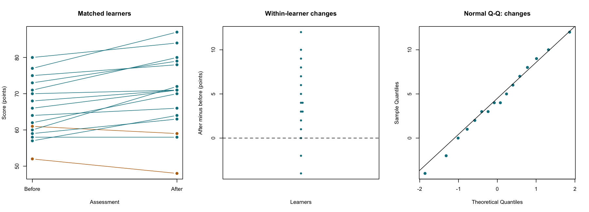

# Paired t-Test

::: {.cdi-message}
- **ID:** STATS-006
- **Type:** Statistical method reference
- **Audience:** Beginner to intermediate learners, researchers, and analysts
- **Theme:** Analyze matched numerical measurements using within-pair differences and explain uncertainty without overstating causation
:::

## 1. Your question

> What is the population mean change in assessment score from before to after training?

The same 16 synthetic learners complete two assessments. Define each learner's change as **after minus before**, in points. Positive changes mean higher scores after training.

The learner is the independent unit. Two scores from each learner form one pair; they are not two independent learners. These are new synthetic data for this chapter.

## 2. When to use this method

Use a paired t-test for two numerical measurements linked by a meaningful pairing, when the target is a population mean difference.

| Example | Pairing unit | Difference |
|---|---|---|
| Assessment before and after training | Learner | After minus before |
| Two measurement devices used on each specimen | Specimen | Device A minus Device B |
| Matched treatment and comparison plots | Matched pair | Treated minus comparison |

Distinct pairs must provide independent information. Matching must be justified by the design, not invented by sorting the outcomes. Matching does not by itself eliminate confounding.

Use an [independent-samples method](05-independent-t-test.qmd) for different, unmatched units in two groups. More than two repeated conditions generally requires a [repeated-measures approach](11-repeated-measures.qmd).

## 3. What it estimates or tests

Let $d_i = \text{after}_i-\text{before}_i$, and let $\mu_d$ denote the population mean change.

- **Null hypothesis:** $H_0: \mu_d=0$.
- **Two-sided alternative:** $H_1: \mu_d\ne0$.
- **Estimate:** The sample mean change, $\bar d$.

The paired t-test is a one-sample t-test on the differences:

$$
t = \frac{\bar d}{s_d/\sqrt{n}}, \qquad df=n-1.
$$

Here, $n$ is the number of complete pairs and $s_d$ is the sample SD of the differences. A 95% interval for the population mean change is:

$$
\bar d \pm t_{0.975,n-1}\frac{s_d}{\sqrt{n}}.
$$

The SE uses variation in the paired differences. It does not come from treating the before and after scores as independent groups.

## 4. Check the pairing and assumptions

| Check | What to establish |
|---|---|
| Matching | Each before score is linked to the correct after score by an identifier |
| Independent pairs | Different learners are independent, with no unaccounted classroom or household clustering |
| Complete pairs | Both measurements are available for each included pair |
| Measurement consistency | Same meaningful scale, units, and comparable assessment procedures |
| Difference distribution | Inspect changes for strong skewness and influential extremes |
| Sampling and timing | Understand recruitment, assessment timing, and other changes between assessments |

For exact small-sample t inference, the differences are assumed normally distributed. The before and after distributions do not each need to be normal. At 16 pairs, inspect the changes carefully rather than treating a normality-test result as a pass/fail rule.

### Preserve identities

The supplied CSV has one row per learner and separate `before` and `after` columns. If the measurements come from separate files, verify unique IDs and perform a checked join. Audit unmatched records and duplicated keys. Never pair the files merely by row position or sort the two score columns separately.

### Missing measurements

An incomplete pair cannot supply an observed within-pair change. Count incomplete pairs and investigate why measurements are missing before deciding how to handle them. Complete-pair analysis can be biased when the retained learners differ systematically from those with missing measurements.

The supplied script stops if scores are missing, allowing you to investigate. It does not silently omit incomplete pairs or impute scores.

## 5. Run the analysis

Copy the supplied files into your repository root:

- [Synthetic paired data](data/example/06-paired-scores.csv)
- [Complete base R script](scripts/R/06-paired-t-test.R)

```bash
Rscript scripts/R/06-paired-t-test.R
```

The following code blocks are non-executable displays. Quarto does not run them. Execute the standalone script to calculate and export the results.

```r
# Each row contains one learner's matched measurements.
dat <- read.csv("data/example/06-paired-scores.csv",
                stringsAsFactors = FALSE)
dat$change <- dat$after - dat$before

# The first vector minus the second defines the direction.
fit <- t.test(dat$after, dat$before, paired = TRUE,
              alternative = "two.sided", conf.level = 0.95)
print(fit)
```

Verify the equivalent calculation on the differences:

```r
check <- t.test(dat$change, mu = 0, alternative = "two.sided",
                conf.level = 0.95)
print(check)
```

| Generated file | Contents |
|---|---|
| `results/tables/06-paired-t-test.csv` | Mean change, uncertainty, and test result |
| `results/tables/06-paired-changes.csv` | Learner IDs, both scores, and each calculated change |
| `results/figures/06-paired-diagnostics.png` | Matched trajectories, individual changes, and Q-Q plot of changes |

These outputs are generated by running the R script and are not included as pre-generated R results. Generate the files before rendering the figure references below.

{#fig-06-paired-diagnostics width=100%}

## 6. Verify and explain the output

Expected results, rounded:

| Quantity | Value |
|---|---:|
| Complete pairs | 16 |
| Mean before | 65.81 points |
| Mean after | 70.06 points |
| Mean change, after minus before | 4.25 points |
| SD of changes | 4.359 points |
| SE of mean change | 1.090 points |
| 95% CI for mean change | 1.93 to 6.57 points |
| t statistic | 3.900 |
| Degrees of freedom | 15 |
| Two-sided p-value | 0.00142 |

For learner L01, the scores are 52 before and 48 after, so the change is **-4 points**. Check this pair before summarizing all changes.

For all learners, the changes sum to 68 points. Verify that $68/16=4.25$, and $4.359/\sqrt{16}\approx1.090$. The test statistic is approximately $4.25/1.090=3.900$.

The interval excludes zero and supports a positive population mean change under the analysis assumptions. It describes uncertainty about the **mean change**, not a range containing 95% of individual changes. Some learners have negative changes even though the average change is positive.

The difference between the two means equals the mean of the differences when calculated from the same complete pairs. The SD and SE still require the actual pairing; the two separate means and SDs alone generally cannot recover the SD of changes without additional covariance information.

### Read the generated plot

- **Matched trajectories:** Each line joins the same learner's two scores. Crossings are possible and are not errors by themselves.
- **Individual changes:** Look for negative values, spread, and unusual changes relative to the others.
- **Q-Q plot:** Assess the shape of the changes, rather than the raw before or after scores separately.

Reversing the order to before minus after reverses the estimate and interval signs, while leaving the two-sided p-value unchanged.

## 7. Use AI and check its suggestions

> I have before and after assessment scores for the same 16 learners, stored as one row per learner with a unique ID. Define change as after minus before. Explain a paired t-test and the relevant assumptions. Show how to check the matching and missing pairs, and verify the equivalent one-sample test on changes. Do not analyze the 32 scores as independent observations or conclude that training caused the change.

Check that the response:

- Uses `paired = TRUE` with after listed first, or a one-sample test of after-minus-before differences.
- Counts 16 pairs and uses 15 degrees of freedom.
- Checks normality of differences rather than requiring both raw distributions to be normal.
- Preserves ID matching and investigates missing pairs.
- Separates evidence of mean change from evidence of a causal training effect.

## 8. Report your finding

> Among 16 synthetic learners with complete paired measurements, the mean score increased from 65.81 to 70.06 points. Mean within-learner change, defined as after minus before, was 4.25 points (SD of changes 4.36; 95% CI 1.93 to 6.57). A two-sided paired t-test yielded $t(15)=3.90$, $p=0.00142$. The results provide evidence of a positive mean change under the test assumptions. Without a suitable comparison design, the change cannot be attributed solely to training.

For an applied report, describe recruitment, timing, diagnostic findings, missing pairs, and relevant changes in assessment procedures or conditions.

## 9. Common mistakes and alternatives

| Mistake | Better approach |
|---|---|
| Treating 32 scores as independent observations | Analyze 16 matched pairs |
| Pairing independently sorted score columns | Match using verified identifiers |
| Checking only the raw score distributions | Examine the within-pair differences |
| Dropping missing pairs without reporting them | Investigate and document missingness and exclusions |
| Assuming pairing removes every source of bias | Assess timing, measurement changes, selection, and confounding |
| Calling a before-and-after change a training effect | Consider practice effects, secular trends, regression to the mean, and other explanations |

If differences are strongly skewed or contain influential extremes, first investigate data quality and the inferential target. A signed-rank test assumes a suitable symmetric difference distribution for a location interpretation and does not generally test the arithmetic mean. A sign test addresses a different target based on direction. Resampling methods also require suitable design and assumptions. Several time points or dependence between pairs may require a more general model.

## 10. Check your understanding

An AI tool sorts the before scores from smallest to largest, independently sorts the after scores, then performs a paired test.

Why is this invalid even if the mean change stays the same?

::: {.callout-note collapse="true"}
## Check your reasoning
Separate sorting destroys the actual learner pairing. Although the difference of means remains the same for complete data, the constructed differences, their SD, the SE, confidence interval, and p-value can change. Restore the verified ID matching before calculating changes.
:::

## Next step

Continue to [Mann–Whitney U Test](07-mann-whitney.qmd) for a rank-based comparison of independent groups. For a paired rank-based method, see [Wilcoxon Signed-Rank Test](08-wilcoxon-signed-rank.qmd).
