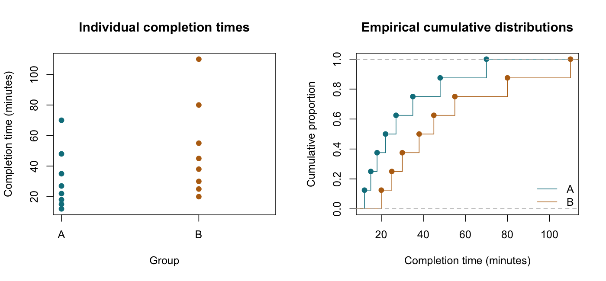

# Mann–Whitney U Test

::: {.cdi-message}
- **ID:** STATS-007
- **Type:** Statistical method reference
- **Audience:** Beginner to intermediate learners, researchers, and analysts
- **Theme:** Compare independent groups using ranks, verify the statistic, and distinguish distributional evidence from claims about medians
:::

## 1. Your question

> Do task completion times tend to be higher in one of two independent groups?

We observe eight synthetic participants in each group. Each participant completes the task once. Lower completion times mean faster completion.

The example emphasizes ordering rather than a difference in arithmetic means. It is a new dataset, separate from the assessment scores in previous chapters.

## 2. When to use this method

The Mann–Whitney U test, also called the **Wilcoxon rank-sum test**, uses the pooled ranks of numerical or ordered outcomes from two independent groups.

It can be useful when ordering is meaningful and the question concerns relative tendency rather than a specific arithmetic mean difference. It does not require normal outcome distributions, but it still requires a suitable sampling design and independent observations.

| Question or design | Consider |
|---|---|
| Rank-based comparison of two independent groups | Mann–Whitney U test |
| Difference in independent population means | [Welch's t-test](05-independent-t-test.qmd) |
| Paired numerical or ordered observations | [Wilcoxon signed-rank method](08-wilcoxon-signed-rank.qmd), with its own conditions |
| Several independent groups | [Kruskal–Wallis test](10-kruskal-wallis.qmd) |

Do not choose this test solely because a normality test gives a small p-value. First identify the quantity or comparison you want to explain.

## 3. What it estimates or tests

For the standard test in this chapter, the null hypothesis is that the two populations have the **same outcome distribution**. Under that null, group labels are exchangeable for the rank calculation. The two-sided procedure detects departures that produce sufficiently unusual rank sums; it is not equally sensitive to every possible difference between distributions.

A useful accompanying effect estimate is:

$$
\theta = P(X_A > X_B) + \tfrac12 P(X_A = X_B).
$$

This describes the probability that a randomly selected A outcome exceeds an independently selected B outcome, with half credit for ties. The sample estimate compares every observed A value with every observed B value.

For completion times, a value below 0.5 means A tends to have **shorter**, not longer, times in this pairwise sense. This is not a within-person improvement probability or evidence of causation.

::: {.callout-note}
## Not automatically a test of medians
If distributions differ only by a location shift and otherwise have the same shape and spread, a location interpretation is reasonable and a shift also corresponds to a difference in medians. Without those additional conditions, rejection should not automatically be described as evidence of different medians.

The usual null-calibrated Mann–Whitney test is also not a generally valid test of only $\theta=0.5$ under arbitrary unequal distributions. Methods designed for that weaker null require separate consideration.
:::

## 4. Check your data and assumptions

- Verify that observations are independent within and between groups.
- Confirm that the outcome has a meaningful order and is measured comparably.
- Check missing values, group labels, duplicate IDs, and unexpected measurements.
- Inspect individual observations and empirical cumulative distribution curves.
- Identify ties, which affect the rank calculation and available p-value methods.
- Assess shape and spread before making a location or median interpretation.

A rank transformation does not remove clustering, confounding, or missing-data bias. Valid extreme observations still matter through their ordering; ranks do not justify ignoring data-quality checks.

### Exact and approximate p-values

This small example has no ties, so we request an exact two-sided p-value. The exact null distribution comes from possible allocations of the pooled ranks to groups of the observed sizes.

For larger samples or tied values, software may use a tie-adjusted normal approximation, possibly with a continuity correction, or a supported permutation procedure. Record the method and settings. Do not ignore software warnings or assume all implementations use the same defaults.

The supplied script stops if ties are introduced because its documented example specifically uses the untied exact calculation. This is a teaching guard, not a claim that tied outcomes cannot be analyzed.

## 5. Run the analysis

Copy the companion folders into your repository root:

- [Synthetic input](data/example/07-completion-times.csv)
- [Complete base R script](scripts/R/07-mann-whitney.R)

```bash
Rscript scripts/R/07-mann-whitney.R
```

All chapter code blocks are non-executable displays. The actual analysis is in the script.

```r
# Explicit order defines the statistic and effect estimate for A relative to B.
dat <- read.csv("data/example/07-completion-times.csv",
                stringsAsFactors = FALSE)
a <- dat$minutes[dat$group == "A"]
b <- dat$minutes[dat$group == "B"]

fit <- wilcox.test(a, b, paired = FALSE, alternative = "two.sided",
                   exact = TRUE, correct = FALSE, conf.int = FALSE)
print(fit)
```

Calculate the directional pairwise effect:

```r
pairwise_scores <- outer(a, b, function(x, y) (x > y) + 0.5 * (x == y))
probability_a_higher <- mean(pairwise_scores)
rank_biserial_a_higher <- 2 * probability_a_higher - 1
```

The script writes these outputs when run:

| Output | Contents |
|---|---|
| `results/tables/07-mann-whitney.csv` | Descriptive medians, U statistics, effect estimates, and exact p-value |
| `results/tables/07-pooled-ranks.csv` | Input records and their pooled ranks |
| `results/figures/07-rank-comparison.png` | Individual values and empirical cumulative distributions |

Pre-generated R outputs are not included. Generate the files before rendering the figure references below.

{#fig-07-rank-comparison width=100%}

## 6. Verify and explain the output

The input times, in minutes, are:

| Group | Values |
|---|---|
| A | 12, 15, 18, 22, 27, 35, 48, 70 |
| B | 20, 25, 30, 38, 45, 55, 80, 110 |

Pooling and ranking all 16 values gives A the ranks **1, 2, 3, 5, 7, 9, 12, 14**, whose sum is 53.

$$
U_A = 53-\frac{8(8+1)}{2}=17.
$$

This convention counts A-greater-than-B pairs, with half credit for ties. Its complementary statistic is $U_B=64-17=47$. Some references report the smaller U, and software labels differ; check the convention rather than comparing statistic names alone.

| Quantity | Expected value |
|---|---:|
| Participants per group | 8 |
| Median A | 24.5 minutes |
| Median B | 41.5 minutes |
| A rank sum | 53 |
| $U_A$ | 17 |
| $U_B$ | 47 |
| Exact two-sided p-value | 0.13038 |
| Estimated $\theta$, A higher than B | 17/64 = 0.265625 |
| Rank-biserial effect, A-higher convention | -0.46875 |

Base R labels its shifted two-sample rank-sum statistic **W**; for this call it equals the $U_A$ defined above, 17. It is not the unshifted rank sum of 53.

A exceeds B in 17 of the 64 cross-group comparisons. Equivalently, A is lower in 47/64, about 73.4%, of these comparisons because there are no ties. These comparisons share participants and are not 64 independent observations.

The sample tends toward lower times in A, but the exact p-value does not provide strong evidence against equal distributions. This does not establish equality or equivalence. The reported medians are descriptive and do not turn the test into a median test.

The rank-biserial value is a directional point estimate, calculated here as $2\hat\theta-1$. We do not provide a confidence interval for it in this introductory example. Avoid treating its magnitude as precisely known with eight participants per group.

### Location estimates require care

For numerical data, some software can estimate a location shift using the median of all cross-group differences, commonly called a Hodges–Lehmann estimate. This is not generally the difference between the two sample medians. A shift interpretation and its interval require appropriate model conditions. This chapter deliberately reports the rank-based probability estimate without asserting a common-shape shift model.

## 7. Use AI and check its suggestions

> Compare task completion times from two independent groups using the supplied CSV. Explain the Mann–Whitney U test with an exact two-sided p-value for these untied observations. Define U for A as the number of A-greater-than-B comparisons and check it against R's reported W. Explain the directional probability estimate, ties, and why the test is not automatically a test of medians. Do not interpret the 64 pairwise comparisons as 64 independent participants.

Verify that the response preserves eight participants per group, distinguishes rank sum 53 from U=17, reports the exact p-value, and explains that lower times indicate faster completion.

If an AI tool says “A's median is significantly lower,” check both the p-value and whether the necessary location-model assumptions support that interpretation.

## 8. Report your finding

> In this synthetic example, completion times had medians of 24.5 minutes in A and 41.5 minutes in B, with eight independent participants per group. A two-sided exact Mann–Whitney test yielded $U_A=17$ and $p=0.1304$. The estimated probability of an A time exceeding a B time was 0.266, indicating a sample tendency toward shorter times in A. The small sample provides limited evidence against equal distributions; the result does not establish equivalence, a median-specific difference, or a causal group effect.

For an applied report, describe sampling, missingness, ties, distributional plots, and the p-value method used.

## 9. Common mistakes and alternatives

| Mistake | Better approach |
|---|---|
| Describing every rank-sum test as a median test | State the null and justify any location interpretation |
| Assuming nonparametric means assumption-free | Check independence, measurement, and null calibration |
| Confusing W, rank sum, and U | State the software's convention and verify the calculation |
| Using the exact untied method after adding ties | Choose and document a procedure that handles ties |
| Interpreting lower times as worse outcomes | Connect the direction to the outcome's meaning |
| Treating p > 0.05 as proof of equality | Report uncertainty and the limits of the sample |

Use Welch's method when the target is an arithmetic mean difference and its conditions are defensible. For inference specifically about a probability-of-superiority parameter with unequal shapes or spreads, consider a method designed for that target, such as a suitable Brunner–Munzel procedure. For paired data, use an appropriate paired method. A change of method must follow the question and design rather than a search for significance.

## 10. Check your understanding

Two groups have the same median but different spreads. An AI response says a Mann–Whitney test must give a large p-value because the medians match.

Is that reasoning sufficient?

::: {.callout-note collapse="true"}
## Check your reasoning
No. Equal medians do not imply identical distributions or determine a rank-sum p-value. The result depends on the full observed ordering and the sampling distribution of the statistic. Conversely, the rank-sum test is not guaranteed to detect every spread difference. Inspect the distributions and state the inferential target before interpreting the result.
:::

## Next step

Continue to [Wilcoxon Signed-Rank Test](08-wilcoxon-signed-rank.qmd) for a paired rank-based analysis.
