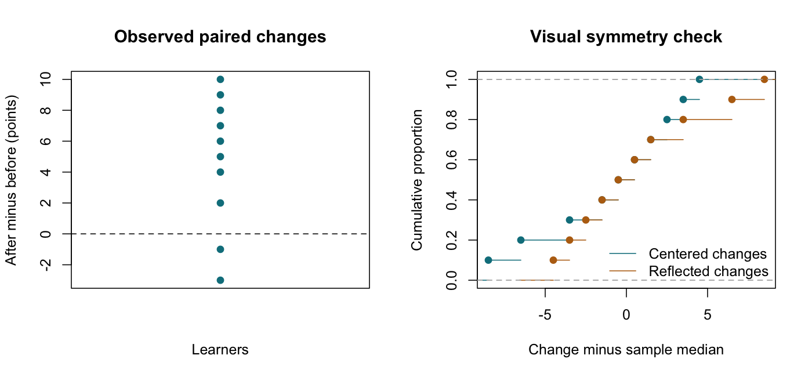

# Wilcoxon Signed-Rank Test

::: {.cdi-message}
- **ID:** STATS-008
- **Type:** Statistical method reference
- **Audience:** Beginner to intermediate learners, researchers, and analysts
- **Theme:** Analyze paired numerical differences using signed ranks, check symmetry, and interpret the result with appropriate limitations
:::

## 1. Your question

> Are paired assessment-score changes centered around zero under a suitable symmetric location model?

Ten synthetic learners have before and after scores. Define change as **after minus before**. Positive values indicate higher scores after training.

This new dataset illustrates a small exact signed-rank calculation. It is separate from Chapter 06's paired t-test example; do not compare their p-values as if they came from the same observations.

## 2. When to use this method

The Wilcoxon signed-rank test uses the signs and ranks of the absolute paired differences. It can support inference about a symmetric location of paired numerical differences without requiring a normal distribution.

The differences and their absolute magnitudes must be meaningful. Arbitrary numerical codes for ordered categories may not provide a defensible scale for this calculation.

| Question or design | Consider |
|---|---|
| Location of paired numerical differences, with plausible symmetry | Signed-rank test |
| Population mean paired difference | [Paired t-test](06-paired-t-test.qmd), when suitable |
| Direction of paired differences without a symmetry assumption | A suitable sign test |
| Independent groups | [Mann–Whitney U test](07-mann-whitney.qmd), with its own target and assumptions |

Do not automatically substitute signed ranks for a paired t-test after a normality test rejects. First consider the target quantity, symmetry, and design.

## 3. What it estimates or tests

For the standard signed-rank test, the null model assumes independent differences from a continuous distribution symmetric about zero. The two-sided test assesses departures from that zero center within an appropriate symmetric location framework.

Symmetry means the distribution has a similar shape on either side of its center. A symmetric distribution need not be normal.

A related location estimate is the **pseudomedian**, estimated by the median of the Walsh averages:

$$
\frac{d_i+d_j}{2}, \qquad i\leq j.
$$

Under symmetry, the population pseudomedian equals the distribution's center and median. In general, it need not equal the population median, and its sample estimate need not equal the sample median of changes.

::: {.callout-note}
## State the assumptions with the interpretation
The signed-rank test is not generally a test of only “median change equals zero” for arbitrary asymmetric distributions. It also does not directly test the arithmetic mean change. If symmetry is implausible, reconsider the inferential target and method.
:::

## 4. Check before running

- Verify each pair using a unique identifier.
- Confirm that different pairs supply independent information.
- Investigate missing measurements and report incomplete pairs.
- Inspect the differences for skewness, asymmetry, and unusual values.
- Count zero differences and repeated absolute differences.
- Check that subtraction and magnitude comparisons are meaningful on the outcome scale.

A small sample provides limited evidence about symmetry. Subject knowledge and the measurement process matter alongside plots. A plot cannot establish independence or rule out missing-data bias.

### Zeros and tied absolute differences

Zero differences have no positive or negative sign. In the usual Wilcoxon convention, zero differences are omitted before ranking; other conventions, such as Pratt's, handle them differently.

Tied absolute differences receive average ranks. Their presence changes the null distribution and p-value calculation. Software may use an approximation or a supported conditional/permutation method. Document the software, zero convention, ties, and exact or approximate calculation.

This example has no zeros or tied absolute differences. The supplied script stops if these occur, preserving this specific exact teaching calculation. That guard does not imply such data are unanalyzable.

## 5. Run the analysis

Copy these companion files into the repository root:

- [Synthetic paired scores](data/example/08-paired-scores.csv)
- [Complete base R script](scripts/R/08-wilcoxon-signed-rank.R)

```bash
Rscript scripts/R/08-wilcoxon-signed-rank.R
```

The following plain code blocks display the analysis. Quarto does not execute them; run the standalone script.

```r
# Pairing is preserved within each learner's row.
dat <- read.csv("data/example/08-paired-scores.csv",
                stringsAsFactors = FALSE)
dat$change <- dat$after - dat$before

fit <- wilcox.test(dat$after, dat$before, paired = TRUE,
                   alternative = "two.sided", exact = TRUE,
                   correct = FALSE, conf.int = FALSE)
print(fit)
```

Verify the signed ranks:

```r
absolute_rank <- rank(abs(dat$change))
v_positive <- sum(absolute_rank[dat$change > 0])
v_negative <- sum(absolute_rank[dat$change < 0])
```

| Generated output | Contents |
|---|---|
| `results/tables/08-signed-rank.csv` | Rank sums, descriptive location estimates, effect estimate, and p-value |
| `results/tables/08-signed-ranks.csv` | Each pair, change, and absolute rank |
| `results/figures/08-change-diagnostics.png` | Individual changes and a visual symmetry comparison |

These outputs are created by the R script and are not supplied as pre-generated R results. Generate the files before rendering the figure references below.

{#fig-08-change-diagnostics width=100%}

## 6. Verify and explain the output

The observed changes are:

**-3, -1, 2, 4, 5, 6, 7, 8, 9, 10 points.**

| Change | Absolute change | Rank of absolute change | Sign |
|---:|---:|---:|---|
| -3 | 3 | 3 | Negative |
| -1 | 1 | 1 | Negative |
| 2 | 2 | 2 | Positive |
| 4 | 4 | 4 | Positive |
| 5 | 5 | 5 | Positive |
| 6 | 6 | 6 | Positive |
| 7 | 7 | 7 | Positive |
| 8 | 8 | 8 | Positive |
| 9 | 9 | 9 | Positive |
| 10 | 10 | 10 | Positive |

The negative rank sum is $3+1=4$. All ranks sum to $10(11)/2=55$, so the positive rank sum is $55-4=51$.

Base R reports the **positive rank sum V=51**. Some other implementations report the smaller signed-rank sum, which is 4 for this two-sided example. Different statistic labels do not necessarily indicate different tests.

| Quantity | Expected value |
|---|---:|
| Complete pairs and nonzero differences | 10 |
| Positive differences | 8 |
| Negative differences | 2 |
| Positive rank sum | 51 |
| Negative rank sum | 4 |
| Exact two-sided p-value | 0.013671875 |
| Sample median change | 5.5 points |
| Estimated pseudomedian | 5.0 points |
| Matched rank-biserial effect, positive-change convention | 47/55 = 0.8545 |

Under the continuous symmetric zero-centered null, each of the $2^{10}=1024$ sign allocations has equal probability conditional on the magnitudes. Seven allocations produce a positive rank sum at most 4; the mirrored upper tail gives an exact two-sided probability of $14/1024=0.013671875$.

This provides evidence against the zero-centered symmetric null, with signed ranks favoring positive changes. It does not establish that every learner improved or that training caused the changes. A location interpretation remains conditional on plausible symmetry.

### Check the pseudomedian

There are $10(11)/2=55$ Walsh averages. Their median is 5.0 points, while the ordinary sample median of changes is 5.5 points. These are different calculations. The script reports both without providing a location confidence interval in this introductory example.

The matched rank-biserial estimate is:

$$
r_{rb}=\frac{V_+-V_-}{V_++V_-}=\frac{51-4}{55}\approx0.8545.
$$

This measures the balance of positive versus negative rank mass under the stated convention. It is not the proportion of learners improving or a percentage increase in scores. It is a point estimate; uncertainty is not quantified here.

### Read the diagnostic figure

The first panel shows individual changes relative to zero. The second compares the empirical distributions of median-centered changes and their reflection. Similar curves are consistent with approximate symmetry around the sample median, but do not prove it. Sampling variability and the small number of pairs limit this visual assessment.

## 7. Use AI and check its suggestions

> Analyze the supplied ten paired synthetic scores using a two-sided Wilcoxon signed-rank test. Define change as after minus before. Check pairing, zeros, tied absolute differences, and the symmetry assumption. Explain why base R reports V=51 while another implementation may report 4. Distinguish the median change, pseudomedian, mean change, and matched rank-biserial estimate. Do not interpret the p-value as proof of a causal training effect.

Verify the changes and ranks yourself. Check that the response reports ten nonzero pairs, positive rank sum 51, negative rank sum 4, and the exact p-value approximately 0.01367.

If it calls this an assumption-free median test, ask it to state the symmetry and measurement conditions needed for that interpretation.

## 8. Report your finding

> In ten synthetic paired observations, eight changes were positive and two were negative. The sample median change was 5.5 points and the estimated pseudomedian was 5.0 points. A two-sided exact Wilcoxon signed-rank test gave a positive rank sum of V=51 and p=0.01367. Under a plausible symmetric difference model, the result supports a positive location shift from zero. The small sample limits assessment of symmetry, and the before-and-after comparison does not establish causation.

For an applied report, add recruitment, timing, missing-pair handling, diagnostic findings, zeros, ties, and the p-value calculation method.

## 9. Common mistakes and alternatives

| Mistake | Better approach |
|---|---|
| Treating different groups as paired | Verify the design and matching identifiers |
| Ranking the raw before and after scores | Rank absolute within-pair differences |
| Ignoring symmetry because the method is nonparametric | Inspect and justify the difference model |
| Calling V the smaller rank sum in every program | Check the software's convention |
| Reporting the pseudomedian as the arithmetic mean | Name the estimate actually calculated |
| Ignoring ties or zero-handling warnings | Choose and document an appropriate procedure |

For an arithmetic mean target, consider the paired t-test when appropriate. A sign test can assess positive versus negative differences without relying on their magnitudes or symmetry; ties and the exact target still need explicit handling. More complex repeated or clustered observations may require a model that reflects their dependence.

## 10. Check your understanding

A report says: “The rank-biserial effect was 0.8545, so 85.45% of learners improved.”

What is wrong?

::: {.callout-note collapse="true"}
## Check your reasoning
The effect is a standardized balance of positive and negative rank sums. It is not a proportion of learners. In this example, eight of ten learners, or 80%, had positive changes. Neither number is a causal improvement estimate.
:::

## Next step

Continue to [One-Way ANOVA](09-one-way-anova.qmd) for comparisons of more than two independent population means.
