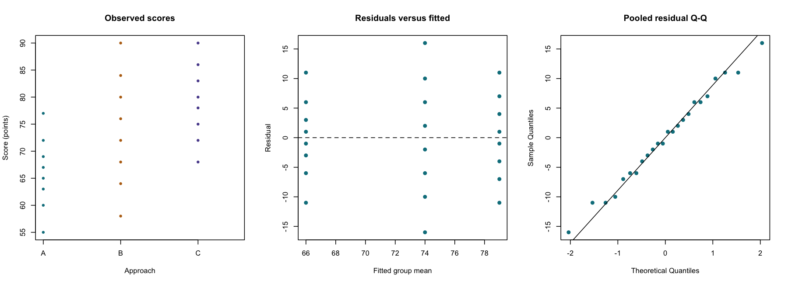

# One-Way ANOVA

::: {.cdi-message}
- **ID:** STATS-009
- **Type:** Statistical method reference
- **Audience:** Beginner to intermediate learners, researchers, and analysts
- **Theme:** Compare several independent population means, distinguish classical and Welch ANOVA, and plan adjusted follow-up comparisons
:::

## 1. Your question

> Do population mean assessment scores differ among teaching approaches A, B, and C?

This example contains 24 synthetic learners, eight per approach. Each contributes one numerical score. We assume independently observed learners for illustration; real classroom clustering would require a different analysis.

The overall question concerns equality of population means. Follow-up questions concern specific differences such as **A minus C**, expressed in score points.

## 2. When to use this method

One-way ANOVA compares a numerical outcome across levels of one categorical grouping variable. “One-way” refers to one grouping factor, not to a one-sided alternative.

| Design or target | Starting method |
|---|---|
| Several independent population means, unequal variances allowed | Welch's one-way ANOVA |
| Several independent means with a defensible common variance | Classical one-way ANOVA |
| Same units measured under several conditions | [Repeated-measures methods](11-repeated-measures.qmd) |
| Several predictors or adjustment variables | An appropriate regression model |
| Rank-based comparison across independent groups | [Kruskal–Wallis](10-kruskal-wallis.qmd), with a different inferential target |

Welch's ANOVA is the primary method in this example. Classical ANOVA is included to explain the variance decomposition and its additional common-variance assumption. Do not select the method that produces the smaller p-value.

## 3. What it estimates or tests

For three groups:

- **Null:** $H_0: \mu_A=\mu_B=\mu_C$.
- **Alternative:** At least one population mean differs.

A small overall p-value does not identify which groups differ, establish that all pairs differ, or measure practical importance.

### Classical ANOVA

Classical ANOVA compares variation among group means with variation within groups:

$$
F=\frac{MS_{\text{between}}}{MS_{\text{within}}}.
$$

With $k$ groups and $N$ independent observations, its degrees of freedom are $k-1$ and $N-k$. Under independent normal errors with a common variance, this ratio has an F distribution under the null.

### Welch's ANOVA

Welch's method uses group-specific variance estimates to weight the means and adjusts the F statistic and degrees of freedom. Its denominator degrees of freedom may be fractional. It does not assume equal population variances, but still depends on suitable independence and distributional conditions.

An overall test answers whether the equal-means null is compatible with the evidence under its assumptions. Group means and pairwise difference estimates explain magnitude and direction.

## 4. Check before running

Check independent units, consistent measurement, group labels, missing values, influential observations, and distributions within each group. Examine group sample sizes and spreads, especially when unequal variances coincide with unequal sample sizes.

Classical ANOVA additionally assumes a common error variance. Normality concerns errors within groups, not the pooled raw outcome distribution. Welch's method accommodates unequal variances but can still be affected by severe skewness, heavy tails, or small groups.

A variance test or normality-test p-value should not automatically determine the analysis. Use design knowledge, plots, and method-specific reasoning. Equal group sizes do not establish equal population variances.

The diagnostic script shows raw group scores, residuals versus fitted group means, and a pooled residual Q-Q plot from the group-means model. The pooled Q-Q plot is only a summary: unequal group variances can affect its shape, so inspect the groups as well. These plots cannot establish independence or causal identification.

## 5. Run the analysis

Copy the supplied files into the repository root:

- [Synthetic scores](data/example/09-three-group-scores.csv)
- [Complete base R script](scripts/R/09-one-way-anova.R)

```bash
Rscript scripts/R/09-one-way-anova.R
```

All code shown in this chapter is non-executable display code. Run the actual script separately.

```r
# Primary analysis: allow unequal group variances.
dat <- read.csv("data/example/09-three-group-scores.csv",
                stringsAsFactors = FALSE)
dat$approach <- factor(dat$approach, levels = c("A", "B", "C"))
welch <- oneway.test(score ~ approach, data = dat, var.equal = FALSE)
print(welch)
```

Classical analysis, for comparison under its additional assumptions:

```r
classical <- aov(score ~ approach, data = dat)
summary(classical)
```

The script exports group summaries, both teaching follow-up tables, the primary Welch overall result, and `results/figures/09-anova-diagnostics.png`. Outputs are generated when you run R; pre-generated R results are not included or needed for chapter rendering.

{#fig-09-anova-diagnostics width=100%}

## 6. Verify and explain the output

| Approach | n | Mean score | Sample SD |
|---|---:|---:|---:|
| A | 8 | 66.00 | 6.91 |
| B | 8 | 74.00 | 10.64 |
| C | 8 | 79.00 | 7.31 |

The unadjusted estimated mean differences are A minus B = -8, A minus C = -13, and B minus C = -5 points.

| Overall method | F | Numerator df | Denominator df | p-value |
|---|---:|---:|---:|---:|
| Welch, primary | 6.468 | 2 | 13.639 | 0.01058 |
| Classical, teaching comparison | 4.816 | 2 | 21 | 0.01899 |

Both calculations concern the same equal-means null but use different variance assumptions and calibrations. The primary Welch result provides evidence that not all population means are equal under its assumptions. It does not establish which pairs differ.

### Verify the classical decomposition

The grand mean is 73 points. With eight learners per group:

$$
SS_{\text{between}}=8[(66-73)^2+(74-73)^2+(79-73)^2]=688.
$$

The within-group sum of squares is 1500. Therefore:

$$
F=\frac{688/2}{1500/21}=4.816.
$$

This arithmetic verifies the classical result, not Welch's statistic. The script calculates Welch directly using `oneway.test()`.

## 7. Follow up with planned comparisons

Decide the comparison family before inspecting which differences look promising. Here, the family is all three two-sided pairwise comparisons.

For the Welch analysis, the script runs separate pairwise Welch tests and applies **Holm adjustment across all three p-values**. This is a defensible approach when the individual Welch tests are appropriately calibrated. Games–Howell is another common unequal-variance pairwise approach, but is not implemented in this base R example.

```r
# Separate variances for each pair; adjust the full three-comparison family.
pairwise.t.test(dat$score, dat$approach, pool.sd = FALSE,
                paired = FALSE, alternative = "two.sided",
                p.adjust.method = "holm")
```

The complete script additionally records each comparison's direction, estimate, degrees of freedom, and unadjusted 95% interval in `results/tables/09-pairwise-welch-holm.csv`.

**Those intervals are ordinary per-comparison intervals, not simultaneous or Holm-adjusted intervals.** Do not label them as family-wise 95% intervals or assume that their exclusion of zero must agree with Holm-adjusted decisions.

For a classical equal-variance analysis, Tukey's procedure supplies adjusted all-pairs comparisons and simultaneous intervals under that model:

```r
TukeyHSD(classical, "approach")
```

The script saves this separately as `09-classical-tukey-teaching.csv`. Tukey's output labels use directions such as B minus A, which differ from the A-minus-B convention in the Welch table. Check direction before reporting.

An omnibus test is not a universal prerequisite for prespecified contrasts with appropriate multiplicity handling. Define the testing strategy in advance rather than using the overall p-value as permission to search freely.

## 8. Use AI and check its suggestions

> Analyze three independent groups using the supplied synthetic scores. Treat Welch's ANOVA as primary. State the equal-means null, check independence and group distributions, and explain why an overall result does not identify specific pairs. For all three pairwise comparisons, use Welch tests with Holm-adjusted p-values. Label ordinary pairwise confidence intervals as unadjusted. Keep a classical ANOVA and Tukey comparison separate for teaching rather than mixing their assumptions with Welch's analysis.

Verify group means, sample sizes, the primary overall result, the comparison family, p-value adjustment, and difference directions. Reject an interpretation that every group differs merely because the overall p-value is small.

## 9. Report your finding

> In the synthetic dataset, mean assessment scores were 66, 74, and 79 points for A, B, and C, respectively, with eight learners per group. Welch's one-way ANOVA provided evidence against equality of the three population means, F(2, 13.64)=6.47, p=0.01058. This overall result does not identify which pairs differ. Follow-up estimates and Holm-adjusted pairwise Welch results should be reported for the prespecified three-comparison family. Interpretation remains conditional on the sampling, independence, and distributional assumptions.

After running the script, add the actual adjusted follow-up results and relevant intervals with their adjustment status. Discuss practical importance in points and avoid attributing the differences to teaching approaches without an appropriate design.

## 10. Common mistakes and alternatives

| Mistake | Better approach |
|---|---|
| Concluding every pair differs from the overall test | Examine planned contrasts or adjusted pairwise comparisons |
| Running many unadjusted tests | Define and handle the comparison family |
| Combining Welch's overall test with unqualified equal-variance follow-up | Use a coherent approach or explain model differences |
| Treating ordinary pairwise intervals as simultaneous | Label coverage and adjustment clearly |
| Using one-way ANOVA for repeated measurements | Account for within-unit dependence |
| Interpreting a nonsignificant result as equal means | Assess precision and meaningful differences |

For severe distributional problems, reassess the outcome, design, and target estimate. Rank-based methods change the inferential target and do not automatically address unequal variances. Covariate adjustment, multiple factors, or clustering may require an appropriate regression or mixed model.

## 11. Check your understanding

An AI report says: “Welch's ANOVA has p=0.01058, so all three teaching approaches differ significantly.”

What additional analysis is needed?

::: {.callout-note collapse="true"}
## Check your reasoning
The overall result only rejects the joint equal-means null. It does not identify all differing pairs. Examine prespecified contrasts or adjusted pairwise comparisons, report their estimates and uncertainty, and explain practical meaning. Some pairs may have weak evidence even when the overall test rejects.
:::

## Next step

Continue to [Kruskal–Wallis Test](10-kruskal-wallis.qmd) for a rank-based comparison across several independent groups.
