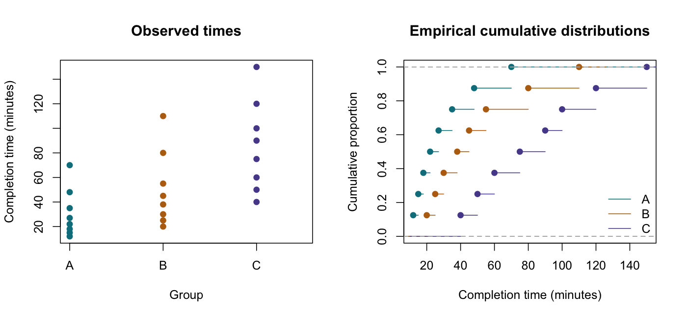

# Kruskal–Wallis Test

::: {.cdi-message}
- **ID:** STATS-010
- **Type:** Statistical method reference
- **Audience:** Beginner to intermediate learners, researchers, and analysts
- **Theme:** Compare several independent groups using pooled ranks, account for ties, and interpret adjusted follow-up comparisons
:::

## 1. Your question

> Do task completion times differ in their rank-based tendency across groups A, B, and C?

This synthetic example has eight independent participants per group, with one completion time per person. Lower values indicate faster completion. Groups A and B reuse the teaching values from Chapter 07; group C adds a third comparison group.

We want a rank-based comparison across groups. If the target is specifically a difference in arithmetic means, consider [one-way ANOVA methods](09-one-way-anova.qmd) instead.

## 2. When to use this method

The Kruskal–Wallis test compares pooled ranks across independent groups. It accommodates numerical or ordered outcomes without assuming normal distributions.

Use it when the outcome ordering is meaningful, units are independent, and its rank-based question fits the goal. It is not an automatic remedy for every violation of ANOVA assumptions.

| Situation | Consider |
|---|---|
| Several independent groups, rank-based comparison | Kruskal–Wallis |
| Two independent groups | [Mann–Whitney U test](07-mann-whitney.qmd) |
| Several measurements on the same units | [Friedman or other repeated-measures methods](11-repeated-measures.qmd) |
| Several population means | Classical or Welch ANOVA, as appropriate |

## 3. What it estimates or tests

The usual null hypothesis is that all groups share the same outcome distribution. Under this null, group labels are exchangeable for the pooled-rank calculation.

The statistic measures differences among group mean ranks. A sufficiently large value provides evidence against the common-distribution null, but the test is not equally sensitive to every possible distributional departure.

For $k$ groups with sample sizes $n_j$, pooled rank sums $R_j$, and total sample size $N$, the uncorrected statistic is:

$$
H=\frac{12}{N(N+1)}\sum_{j=1}^{k}\frac{R_j^2}{n_j}-3(N+1).
$$

With adequate sample sizes under the null, the statistic has an approximate chi-square distribution with $k-1$ degrees of freedom. This is an approximation, not an exact p-value.

::: {.callout-note}
## Not automatically a test of medians
If group distributions have the same shape and spread and differ only by location, a location interpretation is reasonable. Without those conditions, do not label a significant result as proof of different population medians.

Different group spreads can complicate interpretation. Rank-based does not mean assumption-free or universally robust to unequal variances.
:::

## 4. Check before running

Verify independent units, comparable measurements, group labels, missingness, duplicate IDs, and meaningful outcome ordering. Inspect individual values and empirical cumulative distribution curves to understand shape, spread, and overlap.

Ties receive average pooled ranks. The usual statistic is divided by the tie correction:

$$
C=1-\frac{\sum_l(t_l^3-t_l)}{N^3-N},
$$

where $t_l$ is the size of each tied-value block. With no ties, $C=1$. If all values are identical, $C=0$ and the usual statistic is undefined.

Very small groups, sparse ordered categories, or many ties can make the chi-square approximation unreliable. Consider a suitable exact or permutation implementation when needed, preserving any design restrictions. Permuting labels is only justified when the null and sampling or assignment mechanism support exchangeability.

The example has eight observations per group and no ties. We use the conventional chi-square approximation and clearly label it. A sample-size rule alone cannot guarantee accuracy.

## 5. Run the analysis

Copy these files into the repository root:

- [Synthetic completion times](data/example/10-completion-times.csv)
- [Complete base R script](scripts/R/10-kruskal-wallis.R)

```bash
Rscript scripts/R/10-kruskal-wallis.R
```

The chapter displays plain, non-executable code. Run the script separately to generate results and figures.

```r
# Compare pooled ranks across three independent groups.
dat <- read.csv("data/example/10-completion-times.csv",
                stringsAsFactors = FALSE)
dat$group <- factor(dat$group, levels = c("A", "B", "C"))
fit <- kruskal.test(minutes ~ group, data = dat)
print(fit)
```

Verify the pooled ranks:

```r
dat$pooled_rank <- rank(dat$minutes, ties.method = "average")
tapply(dat$pooled_rank, dat$group, sum)
tapply(dat$pooled_rank, dat$group, mean)
```

| Generated file | Contents |
|---|---|
| `results/tables/10-group-ranks.csv` | Sizes, descriptive medians and IQRs, rank sums, and mean ranks |
| `results/tables/10-pooled-ranks.csv` | Each observation and its pooled rank |
| `results/tables/10-kruskal-wallis.csv` | Overall statistic, df, approximate p-value, and tie correction |
| `results/tables/10-pairwise-rank-sum-holm.csv` | Separate pairwise rank-sum tests with Holm adjustment |
| `results/figures/10-group-distributions.png` | Individual values and cumulative distribution curves |

Outputs are generated by the R script. Pre-generated R results are not included or needed for rendering this chapter.

{#fig-10-group-distributions width=100%}

## 6. Verify and explain the output

| Group | n | Sample median, minutes | Pooled rank sum | Mean pooled rank |
|---|---:|---:|---:|---:|
| A | 8 | 24.5 | 57 | 7.125 |
| B | 8 | 41.5 | 96 | 12.000 |
| C | 8 | 82.5 | 147 | 18.375 |

The rank sums total $57+96+147=300$, matching $24(25)/2=300$.

With no ties:

$$
H=\frac{12}{24(25)}\left(\frac{57^2}{8}+\frac{96^2}{8}+\frac{147^2}{8}\right)-3(25)=10.185.
$$

There are $3-1=2$ degrees of freedom. The approximate p-value is **0.006143**.

The result provides evidence against the common-distribution null under the analysis assumptions. The observed ranks tend to increase from A through C, but the overall test does not identify which pairs differ or establish that all pairs differ.

The medians describe the samples. They do not establish a common-shape shift model. Neither the ranks nor the p-value quantify a difference in minutes by themselves.

### Read the generated plots

The individual-value panel shows the actual minute scale and overlap. The cumulative distribution panel shows the fraction of observations at or below each completion time. A higher curve at a given time means more participants have finished by that time. Inspect crossing curves or differences in spread before making a simple location interpretation.

## 7. Plan adjusted follow-up comparisons

For this teaching example, the comparison family includes A versus B, A versus C, and B versus C. The script performs **separate two-sided pairwise Wilcoxon rank-sum tests**, then adjusts all three p-values using Holm's method.

Each pair is ranked separately. These tests are not Dunn's test, which uses the ranks from the full pooled dataset and a corresponding variance calculation. State which procedure you used rather than calling every rank-based follow-up “Dunn.”

The supplied untied pairwise comparisons use exact p-values. If ties are introduced, the script switches each affected pair to a tie-adjusted normal approximation without continuity correction and records this in the output. Review whether that approximation is suitable for the altered sample.

```r
# For this untied dataset: exact pairwise tests with Holm adjustment.
pairwise.wilcox.test(dat$minutes, dat$group, paired = FALSE,
                     alternative = "two.sided", exact = TRUE,
                     correct = FALSE, p.adjust.method = "holm")
```

Use the complete script for per-comparison method labels and U statistics. Do not interpret the overall p-value as an adjusted p-value for any pair. Prespecified contrasts and exploratory follow-up should be distinguished, and multiplicity handled according to the chosen analysis strategy.

## 8. Use AI and check its suggestions

> Analyze three independent groups of completion times using the supplied CSV. Calculate pooled ranks and a tie-corrected Kruskal–Wallis statistic, stating that the conventional p-value uses a chi-square approximation. Explain the distributional null and the extra conditions needed for a median interpretation. For the prespecified three-pair family, use separate pairwise rank-sum tests with Holm adjustment and distinguish these from Dunn's procedure. Do not claim every pair differs from the overall result.

Verify that the response reports N=24, rank sums 57, 96, and 147, H=10.185, df=2, and approximate p=0.006143. Check group sample sizes, ties, adjustment family, and the meaning of lower completion times.

## 9. Report your finding

> In the synthetic example, median completion times were 24.5, 41.5, and 82.5 minutes in A, B, and C, respectively, with eight independent participants per group. A Kruskal–Wallis test provided evidence against a common outcome distribution, H(2)=10.185, approximate p=0.006143. Mean pooled ranks increased from A to C. The overall result does not identify specific differing pairs or establish a median-only difference. Pairwise rank-sum results should be reported with Holm adjustment across the three planned comparisons.

After running the script, add actual adjusted pairwise results. Report the sampling design, missingness, ties, diagnostic findings, and practical context. Avoid causal claims without appropriate design support.

## 10. Common mistakes and alternatives

| Mistake | Better approach |
|---|---|
| Calling the test an assumption-free ANOVA replacement | State the rank-based target and design conditions |
| Claiming all medians differ | Explain the overall null and location assumptions |
| Ignoring ties | Use average ranks and the appropriate correction or null distribution |
| Calling the approximate p-value exact | Report the calculation used |
| Calling separate pairwise rank-sum tests Dunn's test | Name the actual follow-up procedure |
| Analyzing repeated observations as independent | Use a method reflecting within-unit dependence |

For mean differences, consider Welch's ANOVA under suitable conditions. For repeated conditions, consider Friedman or an appropriate repeated-measures model. For adjustment variables, clustering, or more complex designs, choose a model matched to the question and data structure.

## 11. Check your understanding

An AI report says: “The overall p-value is 0.006143, therefore A versus B has p=0.006143.”

What should be corrected?

::: {.callout-note collapse="true"}
## Check your reasoning
The overall statistic uses all three groups and does not supply a p-value for A versus B. Calculate the planned pairwise comparison using the chosen method, include it in the defined multiplicity family, and report its adjusted result. Keep the overall and pairwise questions separate.
:::

## Next step

Continue to [Repeated-Measures ANOVA and Friedman Test](11-repeated-measures.qmd) for observations collected repeatedly from the same units.
