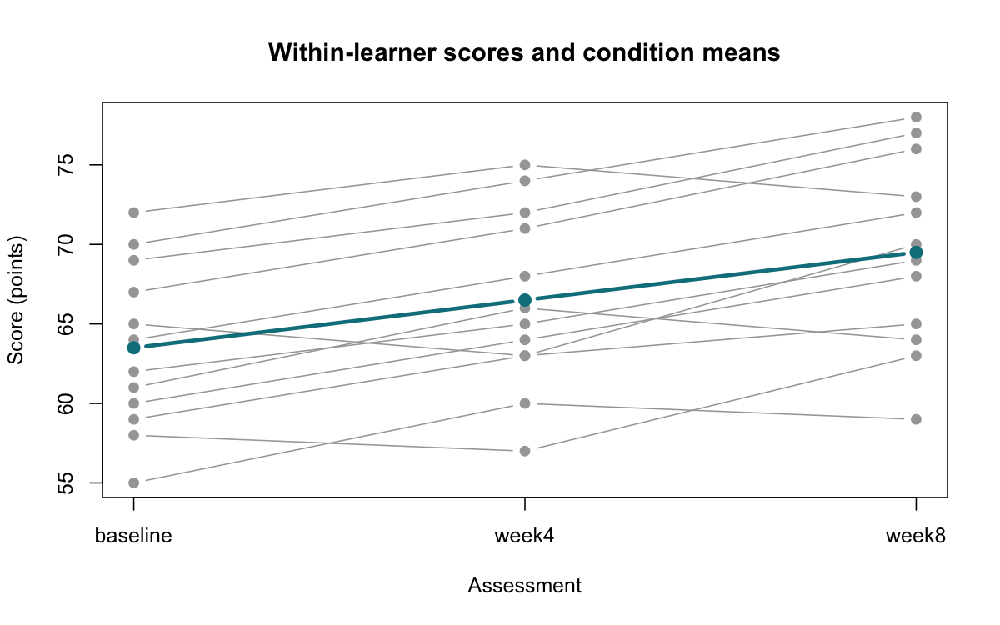

# Repeated-Measures ANOVA and Friedman Test

::: {.cdi-message}
- **ID:** STATS-011
- **Type:** Statistical method reference
- **Audience:** Beginner to intermediate learners, researchers, and analysts
- **Theme:** Analyze several measurements from the same units while respecting dependence, covariance assumptions, and the distinction between means and ranks
:::

## 1. Your question

> Do population mean assessment scores differ across baseline, week 4, and week 8 for the same learners?

Twelve synthetic learners contribute three scores each. There are **12 independent learners and 36 dependent measurements**, not 36 independent learners. Each row of the input contains one learner's three matched scores.

Repeated-measures ANOVA addresses condition means. The Friedman test provides a separate rank-based analysis within learners. They answer different questions; this chapter uses Greenhouse–Geisser-corrected repeated-measures ANOVA as the primary mean-based analysis and Friedman as a teaching comparison.

## 2. When to use these methods

| Situation | Consider |
|---|---|
| Two matched numerical measurements | [Paired t-test](06-paired-t-test.qmd) |
| Several numerical measurements, complete balanced one-factor design | Repeated-measures ANOVA with appropriate covariance handling |
| Complete blocks with one ordered or numerical outcome per condition | Friedman test under suitable block and null assumptions |
| Missing visits, irregular timing, covariates, or complex dependence | An appropriate mixed model, marginal model, or other longitudinal approach |
| Different independent units in every group | [One-way ANOVA](09-one-way-anova.qmd) or [Kruskal–Wallis](10-kruskal-wallis.qmd), as appropriate |

A block is a unit, such as a learner, that supplies an observation under every condition. The basic examples here require complete blocks and one observation per learner-condition combination.

## 3. What repeated-measures ANOVA tests

For three assessment occasions:

- **Null:** The three population condition means are equal.
- **Alternative:** At least one condition mean differs.

The analysis separates stable differences between learners from condition variation and within-learner error. The overall test does not identify specific differing occasions.

### Sphericity

For the usual univariate repeated-measures F test with more than two conditions, **sphericity** requires equal variances of all pairwise difference scores. It is not the same as equal raw score variances at each occasion.

When sphericity fails, the uncorrected F test can have an inflated Type I error rate. Greenhouse–Geisser correction multiplies both degrees of freedom by an estimated epsilon while leaving the F statistic unchanged. The p-value is then recalculated with the corrected degrees of freedom.

The script reports both uncorrected and corrected results and treats the corrected result as primary. It does not implement Mauchly's test or use a preliminary sphericity-test p-value to select the reported result. Correction does not repair independence violations, outliers, biased sampling, or an unsuitable mean model.

## 4. What Friedman tests

Friedman ranks the conditions **within each learner**, then compares condition rank sums across learners. Its usual null calibration assumes that within-block condition labels are exchangeable under the null, with independent blocks. A randomized block design can justify exchangeability; in observational repeated-time data, the null assumptions require care.

The test detects systematic condition differences in within-block ranks. It does not directly test population mean equality and is not automatically a test of equal marginal medians. A location interpretation needs additional model conditions.

Ties within a learner receive average ranks, and the statistic is tie-corrected. Base R's conventional p-value uses a chi-square approximation with k minus 1 degrees of freedom. With few blocks or many ties, consider whether a suitable exact or restricted permutation calculation is needed.

::: {.callout-note}
## A rank test still needs the correct design
Friedman does not remove dependence between learners, account for arbitrary serial covariance, or make time points exchangeable by itself. It also does not establish a causal effect of training.
:::

## 5. Check before running

- Verify unique learner IDs and correct matching across occasions.
- Confirm that learners are independent of one another or model higher-level clustering.
- Check complete visits, consistent units, timing, and measurement procedures.
- Inspect individual trajectories and pairwise difference distributions.
- For mean-based inference, assess influential observations and the distribution of within-person contrasts; multivariate normal errors are a standard sufficient normality condition for classical inference.
- Evaluate covariance assumptions, including sphericity for the uncorrected univariate test.
- For Friedman, verify complete blocks, meaningful ordering, ties, and an appropriate null exchangeability argument.

Missing visits require an explicit strategy. Removing every learner with any missing visit can alter the population represented and introduce bias. The supplied script stops for missing values instead of silently excluding learners. A mixed model may use incomplete records under specified assumptions, but is not automatically immune to missing-data bias.

## 6. Run the analysis

Copy the companion folders into the repository root:

- [Synthetic repeated scores](data/example/11-repeated-scores.csv)
- [Complete base R script](scripts/R/11-repeated-measures.R)

```bash
Rscript scripts/R/11-repeated-measures.R
```

All blocks shown here are non-executable display code. The complete script performs checks, reshapes the data, computes the correction, and exports results.

```r
# Long data need a learner identifier and one condition value per row.
fit <- aov(score ~ condition + Error(learner_id/condition), data = long)
summary(fit)
```

The `aov()` summary above is the **uncorrected** balanced-design analysis. Use the script's separate `p_GG`, `df1_GG`, and `df2_GG` fields for the primary corrected result. Do not describe the printed `aov()` p-value as corrected.

For Friedman, the matrix rows are learners and columns are assessment occasions:

```r
conditions <- c("baseline", "week4", "week8")
x <- as.matrix(dat[conditions])
friedman.test(x)
```

| Generated output | Contents |
|---|---|
| `results/tables/11-repeated-anova.csv` | F statistic, uncorrected results, epsilon, and corrected results |
| `results/tables/11-friedman.csv` | Rank statistic, approximate p-value, and Kendall's W |
| `results/tables/11-condition-summaries.csv` | Means, SDs, and mean within-learner ranks |
| `results/tables/11-paired-t-holm.csv` | Prespecified paired mean comparisons with Holm-adjusted p-values |
| `results/figures/11-trajectories.png` | Individual trajectories and condition means |

Run the R script to generate these files. Pre-generated R outputs are not included or needed to render the chapter.

{#fig-11-trajectories width=100%}

## 7. Verify and explain the output

| Occasion | Learners | Sample mean score |
|---|---:|---:|
| Baseline | 12 | 63.50 |
| Week 4 | 12 | 66.50 |
| Week 8 | 12 | 69.50 |

The descriptive mean changes are +3 points for week 4 minus baseline, +6 for week 8 minus baseline, and +3 for week 8 minus week 4.

| Analysis | Expected result, rounded |
|---|---|
| Uncorrected repeated-measures ANOVA | F(2, 22)=31.8214, p=0.0000003214 |
| Greenhouse–Geisser epsilon | 0.859885 |
| Corrected degrees of freedom | 1.71977 and 18.91747 |
| Primary corrected p-value | 0.000001782 |
| Friedman chi-square statistic | 15.1667, df=2 |
| Friedman approximate p-value | 0.0005089 |
| Kendall's W | 0.63194 |

For the balanced ANOVA, the condition sum of squares is 216 and the within-person error sum of squares is approximately 74.6667:

$$
F=\frac{216/2}{74.6667/22}\approx31.8214.
$$

Both overall procedures provide evidence against their respective nulls under their assumptions. Agreement does not mean they estimate the same quantity or validate the design.

### Verify the Friedman ranks

For learner L01, the scores are 60, 64, and 68, so the within-learner ranks are 1, 2, and 3. Rank separately within every learner; do not pool all 36 scores before ranking.

Kendall's W is calculated here as the tie-corrected Friedman statistic divided by $n(k-1)$:

$$
W=\frac{15.1667}{12(3-1)}\approx0.63194.
$$

It summarizes consistency in condition rankings across blocks. It is not a percentage improvement in scores or a causal effect estimate. No interval for W is provided in this introductory example.

### Read the trajectories

Each gray line follows the same learner through three occasions; the highlighted line connects sample means. Check heterogeneous changes, unusual learners, and measurement patterns. An increasing average does not imply every learner increased at every visit.

## 8. Follow up using the chosen target

For the primary mean-based analysis, the script runs all three **paired t-tests**, preserving learner matching, and Holm-adjusts their p-values as one family. Its pairwise 95% intervals are unadjusted, not simultaneous intervals. Pairwise tests require suitable difference distributions; sphericity is not needed for an individual two-occasion paired test.

For a Friedman analysis, a suitable within-block rank-based follow-up can be considered. Paired signed-rank comparisons with multiplicity adjustment are one option only when their difference-scale and symmetry conditions are defensible; they are not automatically justified by Friedman. The supplied script does not implement rank-based follow-up.

Specify comparison families before inspecting favorable results. An overall result does not imply all occasion pairs differ.

## 9. Use AI and check its suggestions

> Analyze the supplied 12 learners measured at three occasions. Preserve IDs and within-learner matching. Explain repeated-measures ANOVA, sphericity, and Greenhouse–Geisser correction. Separate the corrected mean-based result from a Friedman teaching comparison using within-learner ranks and an approximate chi-square p-value. For mean follow-up, use three paired t-tests with Holm adjustment and label their intervals as unadjusted. Do not treat 36 rows as independent learners or interpret time changes as proof of training effects.

Check the unit count, occasion order, corrected degrees of freedom, correct error term, Friedman ranking direction, and adjustment family. If the response analyzes the occasions as independent groups, correct the design before using its output.

## 10. Report your finding

> In the synthetic example, 12 learners had mean scores of 63.5, 66.5, and 69.5 points at baseline, week 4, and week 8. A repeated-measures ANOVA with Greenhouse–Geisser correction provided evidence of unequal population occasion means, F(1.72, 18.92)=31.82, p=0.000001782, epsilon=0.860. Prespecified paired comparisons should be reported with Holm-adjusted p-values and clearly labeled interval coverage. These time-associated differences do not establish that training caused the changes.

If reporting Friedman instead, state the rank-based target and result: chi-square(2)=15.17, approximate p=0.0005089, W=0.632. Do not report whichever analysis has the smaller p-value as an unplanned choice.

## 11. Common mistakes and alternatives

| Mistake | Better approach |
|---|---|
| Treating repeated scores as independent units | Preserve IDs and within-unit dependence |
| Using equal raw variances as proof of sphericity | Consider variances of within-person contrasts |
| Calling the `aov()` output GG-corrected | Use the separately calculated corrected result |
| Ranking all scores together for Friedman | Rank conditions within each block |
| Ignoring missing visits | Investigate missingness and choose an appropriate strategy |
| Treating time change as a causal intervention effect | Consider controls, secular trends, practice effects, and design |

Mixed models, marginal models, or suitable multivariate approaches may be preferable for more complex covariance structures, irregular occasions, covariates, or incomplete data. Their assumptions and inferential targets must be explained separately.

## 12. Check your understanding

An AI response applies Welch's independent-groups ANOVA to the three occasions because their variances differ.

Why does that fail to address the main design issue?

::: {.callout-note collapse="true"}
## Check your reasoning
Welch's independent-groups method allows unequal group variances but still assumes independence across groups. The same learners contribute at all occasions. Use a method that models or conditions on this within-person relationship; unequal variances do not erase pairing.
:::

## Next step

Continue to [Chi-Square Test of Independence](12-chi-square.qmd) to examine association between categorical variables measured on independent units.
