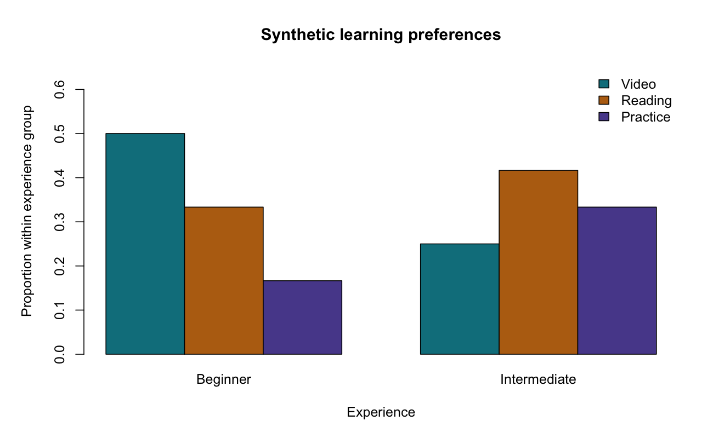

# Chi-Square Test of Independence

::: {.cdi-message}
- **ID:** STATS-012
- **Type:** Statistical method reference
- **Audience:** Beginner to intermediate learners, researchers, and analysts
- **Theme:** Assess association between categorical variables using counts, expected frequencies, and clearly defined proportions
:::

## 1. Your question

> Is preferred learning format associated with experience level?

In a synthetic survey, 120 independent participants each select one preferred format: video, reading, or practice. Experience is classified as beginner or intermediate.

Each person contributes to exactly one cell of a two-by-three contingency table. The input file contains aggregated counts, not individual records.

| Experience | Video | Reading | Practice | Total |
|---|---:|---:|---:|---:|
| Beginner | 30 | 20 | 10 | 60 |
| Intermediate | 15 | 25 | 20 | 60 |
| Total | 45 | 45 | 30 | 120 |

## 2. When to use this method

Pearson's chi-square test of independence assesses association between two categorical variables using cell counts from independent units and an appropriate sampling design.

| Situation | Consider |
|---|---|
| Association in an adequately populated contingency table | Chi-square test of independence |
| Sparse table, particularly a small two-by-two table | [Fisher's exact test](13-fisher-exact.qmd) or another suitable exact/simulation method |
| Before-and-after binary responses from the same people | [McNemar's test](15-mcnemar.qmd) |
| Binary outcome with adjustment variables | [Logistic regression](19-logistic-regression.qmd) |
| Complex survey weights or clustered sampling | A design-based method accounting for the survey structure |

The same Pearson statistic can test homogeneity of category proportions across independently sampled groups. Explain the actual sampling design; it determines which margins are fixed by design and how broadly the result can be generalized.

Do not enter percentages as if they were counts, or ordinary survey weights as if they represented independent people. Multiple-response questions also require care because one person may otherwise be counted in several cells.

## 3. What it tests

- **Null hypothesis:** Experience and learning preference are independent in the population.
- **Alternative:** The variables are associated.

Under independence, each expected count is:

$$
E_{ij}=\frac{(\text{row total}_i)(\text{column total}_j)}{N}.
$$

Pearson's statistic is:

$$
X^2=\sum_{i,j}\frac{(O_{ij}-E_{ij})^2}{E_{ij}},
$$

where $O_{ij}$ is the observed count. Under suitable conditions, the statistic has an approximate chi-square distribution with $(r-1)(c-1)$ degrees of freedom.

This is an overall association test. It does not directly identify causal effects or supply a separate adjusted test for every cell.

## 4. Check counts, categories, and assumptions

Verify that units are independent, categories are mutually exclusive and consistently coded, and counts are nonnegative integers. Investigate missing responses and exclusions. Confirm whether the table represents raw counts or weighted estimates.

Inspect **expected counts**, not only observed counts, when assessing the approximation. A common diagnostic convention is that no expected count is below 1 and at least 80% are at least 5. This is a guideline rather than a universal guarantee; table structure and the sampling model matter.

In this example, the smallest expected count is 15, so sparse expected cells are not a concern. Independence and sampling quality still require design evidence.

A zero observed count is not automatically a problem if its expected count is adequate. A **structural zero**, representing an impossible category combination, changes the model and may invalidate the usual degrees-of-freedom calculation. Entirely empty rows or columns also need investigation.

For a two-by-two table, some software applies Yates's continuity correction by default. This example is two-by-three and explicitly sets `correct = FALSE` for a consistent uncorrected Pearson calculation.

## 5. Run the analysis

Copy the supplied files into your repository root:

- [Synthetic aggregated counts](data/example/12-learning-preferences.csv)
- [Complete base R script](scripts/R/12-chi-square.R)

```bash
Rscript scripts/R/12-chi-square.R
```

The chapter's code blocks are non-executable displays. Run the standalone script to calculate and export results.

```r
# count supplies the frequency for each category combination.
dat <- read.csv("data/example/12-learning-preferences.csv",
                stringsAsFactors = FALSE)
dat$experience <- factor(dat$experience,
                         levels = c("Beginner", "Intermediate"))
dat$preference <- factor(dat$preference,
                         levels = c("Video", "Reading", "Practice"))
tab <- xtabs(count ~ experience + preference, data = dat)
fit <- chisq.test(tab, correct = FALSE)
print(fit)
```

Inspect expected counts and proportions:

```r
fit$expected
prop.table(tab, margin = 1)  # Proportions within each experience row.
fit$stdres                 # Standardized cell residuals.
```

The script exports the overall result, expected counts, row proportions, standardized residuals, cell contributions, and `results/figures/12-preference-proportions.png`. These files are generated when R runs; pre-generated R outputs are not included or required for rendering.

{#fig-12-preference-proportions width=100%}

## 6. Verify and explain the output

Expected counts under independence are:

| Experience | Video | Reading | Practice |
|---|---:|---:|---:|
| Beginner | 22.5 | 22.5 | 15.0 |
| Intermediate | 22.5 | 22.5 | 15.0 |

For beginner-video, the expected count is $60\times45/120=22.5$. Its contribution to the statistic is $(30-22.5)^2/22.5=2.5$.

The total across all six cells is **8.8889**. Degrees of freedom are $(2-1)(3-1)=2$ and the approximate p-value is **0.01174**.

The result provides evidence of an association under the test assumptions. Examine proportions to explain its pattern:

| Experience | Video | Reading | Practice |
|---|---:|---:|---:|
| Beginner | 50.0% | 33.3% | 16.7% |
| Intermediate | 25.0% | 41.7% | 33.3% |

Video preference is 25 percentage points higher among beginners in the sample; practice preference is about 16.7 percentage points lower. These are descriptive comparisons, not individually multiplicity-adjusted inferential findings.

### Effect size: Cramér's V

$$
V=\sqrt{\frac{X^2}{N\min(r-1,c-1)}}\approx0.2722.
$$

Cramér's V summarizes association magnitude on a nonnegative scale. It does not indicate direction or a percentage of explained variation. Interpretation depends on the table and subject context; avoid automatic small/medium/large labels. This example reports an uncorrected point estimate without an interval or small-sample bias adjustment.

### Residuals and cell contributions

A positive standardized residual means a cell has more observations than expected under independence; a negative residual means fewer. Cell contributions show how much each cell adds to the overall statistic.

Residuals are useful diagnostic descriptions, but they are correlated. Searching all cells for large residuals and calling them independently significant requires an appropriate follow-up strategy and multiplicity handling. The script exports residuals without declaring cell-specific significance.

The generated bar chart displays proportions within each experience group, not percentages of the whole sample. State the denominator when explaining a percentage.

## 7. Use AI and check its suggestions

> Use the supplied aggregated counts to assess association between experience and preferred learning format. Construct a two-by-three table using the count column as frequencies, calculate expected counts and the uncorrected Pearson statistic, and check the approximation. Report row proportions and Cramér's V. Distinguish an overall association from individual cell significance and causation. Ask about independent participants, missing responses, and survey weights.

Check that the response uses N=120 rather than six independent observations, obtains df=2, and reports expected counts 22.5, 22.5, and 15 in each row. If it counts one CSV row as one participant, correct the input interpretation first.

## 8. Report your finding

> In the synthetic survey of 120 independent participants, preferred learning format was associated with experience level, Pearson X²(2)=8.89, approximate p=0.01174; Cramér's V=0.272. Video was selected by 50% of beginners and 25% of intermediate participants; practice was selected by 16.7% and 33.3%, respectively. All expected counts were at least 15. The descriptive pattern does not establish that experience causes preference or identify separately adjusted cell-level differences.

For an applied report, describe recruitment, missing responses, category definitions, sampling weights, and any planned follow-up comparisons.

## 9. Common mistakes and alternatives

| Mistake | Better approach |
|---|---|
| Testing percentages as raw counts | Use the original counts and sample denominators |
| Ignoring the input frequency column | Build a weighted frequency table using counts |
| Checking only observed counts for sparsity | Inspect expected counts under the null |
| Treating repeated responses as independent | Use a paired, clustered, or repeated-outcome method |
| Declaring each unusual cell significant | Plan cell or group comparisons with appropriate adjustment |
| Reporting association as causation | Assess design, confounding, and alternative explanations |

For sparse independent tables, consider Fisher's exact test or a suitable Monte Carlo calculation with its conditioning assumptions, seed, and simulation precision recorded. Do not merge categories solely to obtain significance or satisfy a rule; any combination needs a substantive justification. For confounding or several predictors, consider an appropriate categorical-outcome model.

## 10. Check your understanding

A table shows counts of the same learners' preferred formats before and after a course. An AI tool recommends an ordinary independence test because every expected count exceeds five.

What remains wrong?

::: {.callout-note collapse="true"}
## Check your reasoning
The observations are paired within learners. Adequate expected counts do not establish independence. Use a method designed for paired categorical responses; McNemar's test applies to a paired binary outcome, while more than two categories require a suitable generalization or model.
:::

## Next step

Continue to [Fisher's Exact Test](13-fisher-exact.qmd) for independent contingency tables where an exact conditional approach is useful.
