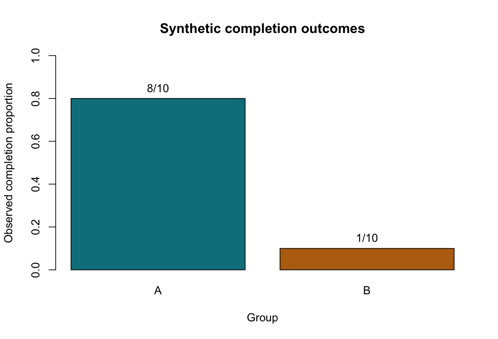

# Fisher's Exact Test

::: {.cdi-message}
- **ID:** STATS-013
- **Type:** Statistical method reference
- **Audience:** Beginner to intermediate learners, researchers, and analysts
- **Theme:** Analyze independent categorical counts using an exact conditional test and interpret odds ratios with their uncertainty
:::

## 1. Your question

> Is task completion associated with group membership?

Twenty independent synthetic participants each contribute one binary outcome. Counts are aggregated in the supplied CSV.

| Group | Completed | Not completed | Total |
|---|---:|---:|---:|
| A | 8 | 2 | 10 |
| B | 1 | 9 | 10 |
| Total | 9 | 11 | 20 |

We define the odds ratio as **completion odds in A divided by completion odds in B**. Set the table order explicitly so the interpretation stays consistent.

## 2. When to use this method

Fisher's exact test is useful for independent contingency tables, particularly small two-by-two tables where chi-square approximations may be questionable. It can also be used with larger counts; it is not restricted to small samples.

| Situation | Consider |
|---|---|
| Small independent two-by-two table | Fisher's exact conditional test |
| Adequately populated independent table | [Pearson chi-square test](12-chi-square.qmd), under suitable conditions |
| Paired binary responses | [McNemar's test](15-mcnemar.qmd) |
| Binary outcome with adjustment variables | [Logistic regression](19-logistic-regression.qmd) |

Exact inference does not remove the need for independent units, appropriate sampling, or correct category definitions. Complex survey weights, repeated responses, and clustering require appropriate methods.

## 3. What it tests

In the two-by-two setting, the null hypothesis is that the population odds ratio equals one: no association between row and column categories under the sampling model.

Fisher's test conditions on the observed row and column totals. Under the null, the top-left cell follows a hypergeometric distribution. The calculation considers tables with these same margins.

The usual two-sided definition used by R sums the null probabilities of tables whose probabilities are no greater than that of the observed table, allowing for numerical tolerance. A two-sided p-value is not always twice the smaller one-sided p-value. State the software and definition when comparing implementations.

“Exact” refers to calibration using the conditional null distribution rather than a large-sample approximation. It does not mean the interpretation is certain or that the effect is precisely estimated. Because counts are discrete, achievable p-values are also discrete and tests can be conservative.

## 4. Check before running

Verify that:

- Each participant contributes to one cell only.
- Counts are nonnegative integers, not percentages or ordinary survey weights.
- Rows and columns represent clearly defined, mutually exclusive categories.
- Missing outcomes and exclusions are investigated.
- Sampling or assignment supports the conditional analysis and intended generalization.
- Structural zeros, impossible combinations, and empty margins are addressed.

Expected counts here are 4.5 completed and 5.5 not completed in each row. The small expected counts motivate examining an exact approach rather than relying only on a chi-square approximation.

A zero observed cell does not prevent Fisher's test when margins are valid, but odds-ratio estimates or interval limits may be zero or infinite. Do not add an arbitrary constant to all cells merely to make software output finite; any correction changes the estimation procedure and needs justification.

## 5. Run the analysis

Copy these files into your repository root:

- [Synthetic aggregated counts](data/example/13-completion-counts.csv)
- [Complete base R script](scripts/R/13-fisher-exact.R)

```bash
Rscript scripts/R/13-fisher-exact.R
```

All blocks displayed here are non-executable. Run the standalone script to calculate and export results.

```r
# Explicit row and column order defines completion odds in A relative to B.
tab <- matrix(c(8, 2, 1, 9), nrow = 2, byrow = TRUE,
              dimnames = list(group = c("A", "B"),
                              outcome = c("Completed", "Not_completed")))
fit <- fisher.test(tab, alternative = "two.sided", conf.level = 0.95)
print(fit)
```

The full script reads these counts from the CSV and checks their structure before testing.

```r
# Descriptive cross-product estimate, distinct from the conditional estimate.
cross_product_or <- (tab[1, 1] * tab[2, 2]) /
                    (tab[1, 2] * tab[2, 1])
fit$estimate
fit$conf.int
```

The script exports `results/tables/13-fisher-exact.csv` and `results/figures/13-completion-proportions.png`. The figure displays observed proportions with count denominators, without inferential error bars. Outputs are generated when the R script runs and are not required for chapter rendering.

{#fig-13-completion-proportions width=100%}

## 6. Verify and explain the output

| Quantity | Expected value, rounded |
|---|---:|
| Independent participants | 20 |
| Completion proportion in A | 8/10 = 0.80 |
| Completion proportion in B | 1/10 = 0.10 |
| Descriptive proportion difference, A minus B | 0.70, or 70 percentage points |
| Cross-product sample odds ratio | 36 |
| Conditional maximum-likelihood odds ratio | Approximately 27.33 |
| Exact conditional 95% odds-ratio interval | Approximately 2.06 to 1767 |
| Exact two-sided p-value | 0.0054775 |

R's numerical optimization may give slightly different final digits for the conditional estimate and interval limits.

### Verify the p-value

The observed table's null probability is:

$$
P(A_{11}=8)=\frac{\binom{9}{8}\binom{11}{2}}{\binom{20}{10}}.
$$

For these symmetric row totals, tables with top-left counts 0, 1, 8, and 9 have probabilities no greater than the observed table's. Summing their probabilities gives approximately 0.0054775.

This provides evidence against the no-association null under the conditional model. It is not the probability that the null is true or that the difference was caused by chance.

### Distinguish the odds-ratio estimates

The completion odds are 8/2 in A and 1/9 in B, giving:

$$
\widehat{OR}_{\text{cross-product}}=\frac{8/2}{1/9}=36.
$$

Base R's `fisher.test()` instead reports the **conditional maximum-likelihood estimate**, approximately 27.33, based on the conditional model. The two estimates need not agree in small samples. Report which estimate you use and pair it with an interval from the stated procedure.

The conditional interval is very wide despite the small p-value. The evidence against OR=1 does not mean we know the association magnitude precisely.

### Odds are not probabilities

The sample completion proportion ratio is 0.80/0.10=8, while the cross-product odds ratio is 36. An odds ratio of 36 does not mean participants are 36 times as likely to complete. Which probability measures are estimable also depends on sampling design; case-control samples do not directly estimate population risks from sampled row proportions without additional information.

Reversing one dimension of the table reciprocates the odds ratio. Reversing both dimensions restores it. The two-sided association p-value is unchanged by such relabeling, but interpretation still requires correct labels.

## 7. Larger tables and simulation

R supports exact conditional testing for tables larger than two-by-two, but computation may become demanding. A supported Monte Carlo calculation can approximate the conditional p-value when appropriate. If used, report the random seed, simulation count, and Monte Carlo uncertainty; do not label the simulated number as a fully enumerated exact p-value.

A single two-by-two odds ratio does not summarize a general multirow or multicolumn association. Additional contrasts or models need their own definitions and multiplicity strategy.

## 8. Use AI and check its suggestions

> Analyze the supplied independent two-by-two counts with a two-sided Fisher exact test. Preserve rows A, B and columns Completed, Not completed. Explain conditioning on margins and distinguish the cross-product odds ratio from R's conditional estimate. Report the exact conditional interval and interpret its width. Do not describe odds ratios as probability ratios or claim a causal effect.

Check that the response uses N=20 rather than four observations, gives the correct table orientation and p-value, distinguishes the two odds-ratio estimates, and recognizes substantial uncertainty in magnitude.

## 9. Report your finding

> In the synthetic sample, 8 of 10 participants in A and 1 of 10 in B completed the task. A two-sided Fisher exact test provided evidence of association, p=0.00548. The conditional odds ratio for completion in A relative to B was approximately 27.33, with an exact conditional 95% interval of approximately 2.06 to 1767. The wide interval reflects substantial uncertainty in association magnitude. The comparison does not establish causation.

For an applied report, add recruitment or assignment, missingness, the table orientation, software, and the inferential procedure. Do not present this synthetic result as evidence about real programs.

## 10. Common mistakes and alternatives

| Mistake | Better approach |
|---|---|
| Treating exact as assumption-free | Check independence, categories, and sampling |
| Doubling a one-sided p-value without checking the definition | Use the stated two-sided procedure |
| Calling an odds ratio a risk ratio | Explain the difference between odds and probabilities |
| Mixing a cross-product estimate with an unlabeled conditional interval | State the estimate and interval procedures |
| Treating a small p-value as precise effect estimation | Report the interval and its width |
| Applying ordinary Fisher testing to matched binary outcomes | Use an appropriate paired method |

Alternative independent two-proportion procedures, including unconditional exact methods, condition differently and may have different operating characteristics. Choose a defensible approach before comparing p-values. For paired outcomes, use McNemar; for adjustment or more complex designs, use an appropriate model.

## 11. Check your understanding

An AI tool reports an odds ratio of 36 and says: “Participants in A are 36 times as likely to complete the task.”

How should this be corrected?

::: {.callout-note collapse="true"}
## Check your reasoning
Thirty-six is the sample ratio of completion odds, not completion probabilities. The observed proportions are 80% and 10%, whose ratio is eight. Report the intended measure, its uncertainty, and the sampling assumptions. R's Fisher output uses a different conditional odds-ratio estimate, approximately 27.33.
:::

## Next step

Continue to [Tests for Proportions](14-proportions.qmd) to compare a single population proportion with a reference or compare independent proportions directly.
