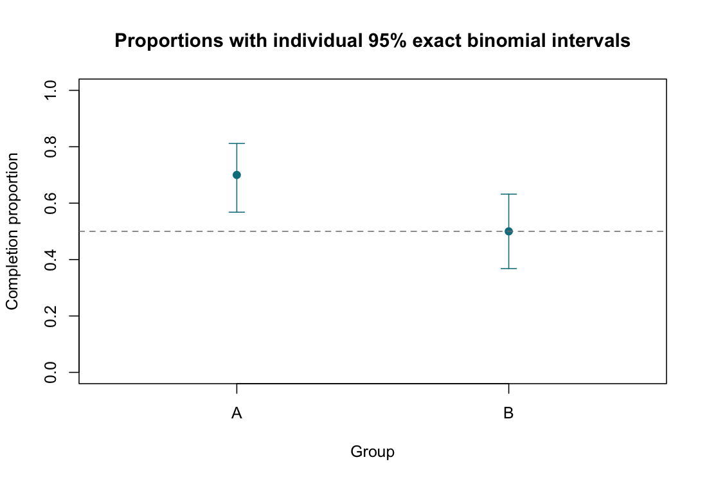

# Tests for Proportions

::: {.cdi-message}
- **ID:** STATS-014
- **Type:** Statistical method reference
- **Audience:** Beginner to intermediate learners, researchers, and analysts
- **Theme:** Estimate binary outcome proportions, compare them with a reference or another independent group, and report absolute differences with uncertainty
:::

## 1. Your questions

This chapter uses two related questions:

1. Does the population completion proportion for A differ from a fixed reference of 50%?
2. How much does the completion proportion differ between independent groups A and B?

The synthetic dataset contains 120 independent participants. Each contributes one completed/not-completed outcome.

| Group | Completed | Not completed | Total | Completion proportion |
|---|---:|---:|---:|---:|
| A | 42 | 18 | 60 | 70% |
| B | 30 | 30 | 60 | 50% |

These are separate teaching questions, not a reason to search among analyses for a small p-value. In an applied project, specify primary questions and any multiplicity strategy before analysis.

## 2. When to use these methods

A proportion is the number with the defined outcome divided by the number eligible for its denominator.

| Target | Starting method |
|---|---|
| One population proportion against a fixed reference | Exact binomial test or suitable score-based procedure |
| Difference between two independent population proportions | Appropriate two-proportion test and difference interval |
| Sparse independent two-by-two table | [Fisher's exact test](13-fisher-exact.qmd), with conditional assumptions |
| Paired binary outcomes | [McNemar's test](15-mcnemar.qmd) |
| Binary outcome with covariate adjustment | [Logistic regression](19-logistic-regression.qmd) |

The simple binomial model assumes independent binary trials with a common outcome probability within each group. Clustered observations, complex surveys, overdispersion, and repeated outcomes require methods reflecting their design.

## 3. Define the outcome and denominator

State what counts as completion, the assessment window, and who belongs in the denominator. Missing or pending outcomes should not silently become failures or disappear from the denominator.

Do not compare percentages without their sample sizes. A proportion of 70% from seven of ten people has different precision from 700 of 1000.

The input CSV stores completed counts and totals. `total` is the denominator, not the number who did not complete. Check that completed counts are integers between zero and total.

## 4. What the tests estimate or test

### One proportion

Let $p_A$ be the population completion probability in A.

- **Null:** $p_A=0.50$.
- **Two-sided alternative:** $p_A\ne0.50$.
- **Estimate:** $\hat p_A=42/60=0.70$.

We use an exact binomial test and a Clopper–Pearson exact interval. The interval has at least nominal coverage under the binomial model and can be conservative because outcomes are discrete.

The two-sided exact p-value sums null probabilities of outcomes no more probable than the observed outcome under the specified procedure. It is not always twice a one-sided p-value, and the equal-tailed interval need not be the exact inversion of every two-sided p-value definition.

### Two independent proportions

- **Null:** $p_A-p_B=0$.
- **Two-sided alternative:** $p_A-p_B\ne0$.
- **Estimate:** $0.70-0.50=0.20$, or **20 percentage points**.

For the uncorrected large-sample equal-proportions test, the pooled estimate under the null is $\hat p=(42+30)/(60+60)=0.60$:

$$
z=\frac{\hat p_A-\hat p_B}
{\sqrt{\hat p(1-\hat p)(1/n_A+1/n_B)}}.
$$

R reports the equivalent chi-square statistic $X^2=z^2$ with one degree of freedom.

## 5. Check before running

Verify independent participants within and between groups, consistent outcome definitions, complete denominators, missingness, and the sampling process. A fixed reference must be chosen for substantive reasons; a reference estimated from another sample carries uncertainty.

For a normal-approximation test, check expected event and non-event counts under the null. Here they are 36 and 24 in each group, so sparsity is not a concern. Approximate intervals can still perform poorly near zero or one or with small samples.

For interval estimation, score-based methods for single proportions and Newcombe or other suitable methods for differences may offer better coverage than a simple Wald interval. This base R example explicitly labels the two-sample interval it uses instead of presenting it as exact.

## 6. Run the analysis

Copy the supplied files into the repository root:

- [Synthetic summary counts](data/example/14-completion-summary.csv)
- [Complete base R script](scripts/R/14-proportions.R)

```bash
Rscript scripts/R/14-proportions.R
```

All chapter blocks are non-executable displays. Run the actual script separately.

```r
# One-sample exact test against a fixed 50% reference.
one <- binom.test(42, 60, p = 0.50,
                  alternative = "two.sided", conf.level = 0.95)
print(one)

# Independent two-sample comparison: A first, then B.
two <- prop.test(x = c(42, 30), n = c(60, 60),
                 alternative = "two.sided", correct = FALSE,
                 conf.level = 0.95)
print(two)
```

The complete script reads the counts from the CSV, validates them, and writes:

| Output | Contents |
|---|---|
| `results/tables/14-one-proportion.csv` | A's proportion, exact interval, and exact p-value |
| `results/tables/14-two-proportions.csv` | A-minus-B difference, approximate interval, and test result |
| `results/figures/14-completion-proportions.png` | Group proportions with individual exact binomial intervals |

Outputs are generated when R runs; pre-generated R results are not included or needed for chapter rendering.

{#fig-14-completion-proportions width=100%}

## 7. Verify and explain the output

### Single proportion

| Quantity | Expected value, rounded |
|---|---:|
| Completion proportion in A | 0.700 |
| Exact 95% interval | 0.5679 to 0.8115 |
| Reference | 0.500 |
| Exact two-sided p-value | 0.0026704 |

The data provide evidence against the 50% reference under the binomial model, with an estimate above it. The interval quantifies uncertainty about the population proportion, not the percentage of individuals whose outcomes are uncertain.

### Difference in independent proportions

| Quantity | Expected value, rounded |
|---|---:|
| A minus B | 0.200, or 20 percentage points |
| Approximate unpooled-normal 95% interval | 0.02839 to 0.37161 |
| Pearson chi-square statistic | 5.000 |
| Degrees of freedom | 1 |
| Approximate p-value | 0.02535 |

With `correct = FALSE`, base R's two-sample `prop.test()` reports an unpooled normal-approximation interval for the difference:

$$
(\hat p_A-\hat p_B)\pm1.96\sqrt{
\frac{\hat p_A(1-\hat p_A)}{n_A}+\frac{\hat p_B(1-\hat p_B)}{n_B}}.
$$

The p-value uses the pooled null SE; the interval uses the unpooled SE. These are different constructions, and threshold agreement is not guaranteed for all datasets. This interval is approximate, not an exact conditional interval or a score-based difference interval.

The estimated difference is 20 percentage points, with an approximate interval from 2.84 to 37.16 percentage points. Consider whether that range includes differences important to the intended decision.

### Percentage points versus relative change

The difference from 50% to 70% is **20 percentage points**. Relative to B, it is a descriptive relative increase of $(0.70-0.50)/0.50=40\%$. The sample proportion ratio is 1.4. These measures answer different questions; state which you report. In designs such as case-control sampling, sample proportions may not directly estimate population risks.

### Read the figure

The plotted intervals describe each group proportion separately. They are not intervals for the difference and are not simultaneous intervals. Do not decide whether groups differ solely by whether separate intervals overlap; use the difference estimate and its appropriate inference.

## 8. Use AI and check its suggestions

> Analyze the supplied independent completion counts. For A versus a fixed 50% reference, use a two-sided exact binomial test with an exact interval. For A minus B, use the specified uncorrected two-proportion test and label its difference interval as approximate unpooled normal. Check counts, denominators, independence, missingness, and expected counts. Distinguish percentage points, relative change, and proportion ratios. Do not treat individual interval overlap as a test of the difference.

Verify numerators, denominators, group order, reference, sidedness, continuity-correction setting, and interval method. An AI statement of “20% higher” is ambiguous until the scale is specified.

## 9. Report your finding

For the independent-group question:

> In the synthetic example, 42 of 60 participants in A and 30 of 60 in B completed the task. The estimated proportion difference, A minus B, was 20 percentage points (approximate unpooled-normal 95% CI 2.84 to 37.16 percentage points). An uncorrected two-proportion Pearson test gave X²(1)=5.00, p=0.02535. The estimate favors A, but its magnitude remains uncertain and causal interpretation depends on the study design.

For the separate one-sample question, report A's 70% estimate, exact 95% interval 56.79% to 81.15%, fixed 50% reference, and exact p=0.00267. Avoid combining multiple tests into an unexplained single conclusion.

## 10. Common mistakes and alternatives

| Mistake | Better approach |
|---|---|
| Entering failures as the denominator | Use total eligible trials or participants |
| Treating missing outcomes as known failures | Investigate and state handling rules |
| Calling 70% versus 50% a 20% relative increase | Report 20 percentage points or 40% relative increase |
| Calling every proportion interval exact | Name the interval procedure |
| Comparing paired proportions as independent | Use an appropriate paired method |
| Declaring equality when p > 0.05 | Assess precision and meaningful differences |

Consider exact methods for sparse outcomes, better-performing difference intervals when appropriate, and design-based methods for weighted or clustered samples. Covariate adjustment requires an appropriate binary-outcome model. A method change should follow the question and its assumptions rather than a preferred p-value.

## 11. Check your understanding

A report says: “Completion rose from 50% to 70%, a 20% increase.”

How can you make the statement unambiguous?

::: {.callout-note collapse="true"}
## Check your reasoning
State either “20 percentage points higher” or “40% higher relative to 50%,” depending on the intended measure. For this independent-group example, “rose” could wrongly imply repeated measurements over time; say “was higher in A than B” and report uncertainty.
:::

## Next step

Continue to [McNemar's Test](15-mcnemar.qmd) for binary measurements paired within the same participants.
