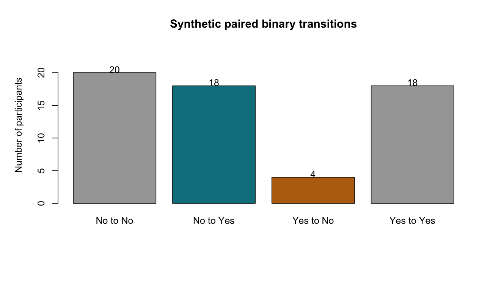

# McNemar's Test

::: {.cdi-message}
- **ID:** STATS-015
- **Type:** Statistical method reference
- **Audience:** Beginner to intermediate learners, researchers, and analysts
- **Theme:** Compare paired binary outcomes using discordant pairs and distinguish marginal change from association
:::

## 1. Your question

> Does the population proportion able to complete a task differ before and after training?

Sixty synthetic participants are assessed twice with the same binary outcome: **Yes** or **No**. Each participant supplies one complete pair. Rows refer to before and columns to after.

| Before / After | No | Yes | Before total |
|---|---:|---:|---:|
| No | 20 | 18 | 38 |
| Yes | 4 | 18 | 22 |
| After total | 24 | 36 | 60 |

The 18 No-to-Yes transitions are **gains** and the four Yes-to-No transitions are **losses**. These two off-diagonal cells are the discordant pairs.

## 2. When to use this method

McNemar's test compares the marginal probabilities of a binary outcome in paired measurements. Examples include before-and-after task completion or two binary diagnostic classifications on the same specimens.

| Design or question | Consider |
|---|---|
| Two paired binary outcomes | McNemar's test |
| Independent binary groups | [Tests for proportions](14-proportions.qmd) or [Fisher's exact test](13-fisher-exact.qmd) |
| Paired categorical outcome with more than two categories | A suitable marginal-homogeneity generalization |
| More than two repeated binary measurements | Cochran's Q under suitable conditions, or an appropriate repeated-outcome model |
| Adjustment variables or clustering between participants | A suitable paired or longitudinal binary-outcome model |

Do not apply an ordinary independence test to the before-by-after transition table when the question is marginal change. Independence of before and after is a different null from equality of their marginal Yes probabilities.

## 3. What it estimates or tests

Let $p_{NY}$ denote the population probability of No before and Yes after, and $p_{YN}$ the reverse.

- **Null:** $p_{NY}=p_{YN}$, equivalent to equal marginal Yes probabilities.
- **Two-sided alternative:** The transition probabilities differ.
- **Effect estimate:** The after-minus-before Yes proportion difference.

For complete pairs:

$$
\widehat\Delta=\hat p_{\text{after}}-\hat p_{\text{before}}
=\frac{\text{gains}-\text{losses}}{n}.
$$

The concordant pairs remain relevant to the marginal proportions and their denominator, but they do not distinguish gains from losses in the conditional test.

### Exact conditional test

Condition on the number of discordant pairs, $m$. Under the null, gains follow a binomial distribution with $m$ trials and probability 0.5. We use a two-sided exact binomial test as the primary procedure.

### Approximate McNemar test

With sufficient discordant information, the uncorrected statistic is:

$$
X^2=\frac{(\text{gains}-\text{losses})^2}{\text{gains}+\text{losses}},
$$

compared with a chi-square distribution with one degree of freedom. A continuity-corrected version reduces the numerator's absolute difference by one before squaring in this example. Exact and approximate p-values need not match.

## 4. Check the pairs and input

Verify matching identifiers in the underlying records, consistent outcome definitions, complete paired assessments, and independence between participants. Several participants from the same household or classroom may require additional dependence handling.

The supplied CSV contains four aggregated transition counts. It cannot verify matching or reveal whether missing visits were excluded. An applied workflow should audit individual records before aggregation.

Use actual counts, not percentages. Confirm row and column direction and ensure categories are identical at both occasions. Investigate incomplete pairs; simply dropping them can bias the comparison if missingness relates to outcome or change.

The amount of discordant information matters more to the conditional test than the total sample alone. Here, 22 pairs are discordant. We use the exact conditional method without selecting a procedure according to which gives the smallest p-value.

If there are **no discordant pairs**, there is no observed directional change to test conditionally. The supplied script stops for this case. Report the lack of discordance without claiming that population change is proven absent; estimation and uncertainty still require care.

## 5. Run the analysis

Copy the supplied files into the repository root:

- [Synthetic paired transition counts](data/example/15-paired-binary-counts.csv)
- [Complete base R script](scripts/R/15-mcnemar.R)

```bash
Rscript scripts/R/15-mcnemar.R
```

The following plain blocks are non-executable. Run the standalone script to produce results and the transition plot.

```r
# Rows are before; columns are after. Both use No, Yes order.
tab <- matrix(c(20, 18, 4, 18), nrow = 2, byrow = TRUE,
              dimnames = list(before = c("No", "Yes"),
                              after = c("No", "Yes")))
gains <- tab["No", "Yes"]
losses <- tab["Yes", "No"]

# Primary exact conditional test among discordant pairs.
exact <- binom.test(gains, gains + losses, p = 0.5,
                    alternative = "two.sided")
print(exact)
```

For the teaching comparison of approximations:

```r
mcnemar.test(tab, correct = FALSE)
mcnemar.test(tab, correct = TRUE)
```

The full script reads and validates the CSV, writes `results/tables/15-mcnemar.csv`, and saves `results/figures/15-paired-transitions.png`. Pre-generated R outputs are not included; generate the files before rendering this chapter.

{#fig-15-paired-transitions width=100%}

## 6. Verify and explain the output

| Quantity | Expected value |
|---|---:|
| Complete pairs | 60 |
| Yes before | 22/60 = 36.67% |
| Yes after | 36/60 = 60.00% |
| Gains | 18 |
| Losses | 4 |
| Discordant pairs | 22 |
| After-minus-before proportion difference | 14/60 = 23.33 percentage points |
| Exact conditional two-sided p-value | 0.00434351 |
| Uncorrected chi-square statistic | 8.9091 |
| Uncorrected approximate p-value | 0.0028375 |
| Continuity-corrected statistic | 7.6818 |
| Corrected approximate p-value | 0.0055780 |

Check that gains plus losses equal 22 and that the net Yes count increases by $18-4=14$. The conditional null expects 11 gains among the 22 discordant pairs, compared with 18 observed.

The primary result provides evidence against equal marginal Yes probabilities under the paired-data assumptions. The sample direction favors higher completion after training. It does not establish that training caused the increase.

### Do not confuse the binomial estimate with the marginal change

`binom.test()` prints an estimate of $18/22\approx0.8182$ and an interval for the conditional probability of a gain **among discordant pairs**. This is not the overall after completion proportion, nor an interval for the paired marginal difference of 0.2333.

The script deliberately does not export that conditional interval as an interval for overall change. A paired risk-difference interval requires a method that uses the matched structure; subtracting separate independent-proportion interval limits is not a substitute. This introductory example reports the marginal difference as a point estimate and leaves its interval for a dedicated matched-proportion estimation extension.

### Read the plot

The transition figure shows four mutually exclusive participant groups. Compare the two colored discordant bars to understand the test's directional evidence. The unchanged groups contribute to the total population represented, even though they do not enter the conditional binomial test.

## 7. Use AI and check its suggestions

> Analyze these complete paired binary transitions: No-to-No 20, No-to-Yes 18, Yes-to-No 4, Yes-to-Yes 18. Use a two-sided exact conditional McNemar procedure through a binomial test on discordant pairs. Report before and after marginal Yes proportions and the after-minus-before difference. Distinguish the binomial estimate among discordants from the overall change. Do not use an independent two-proportion test or describe the change as caused by training.

Verify N=60 pairs, m=22 discordants, 18 gains, four losses, exact p approximately 0.00434, and the marginal increase of 23.33 percentage points. If a response uses all 60 pairs as binomial trials with 18 successes for the conditional test, correct the denominator.

## 8. Report your finding

> In 60 complete synthetic paired observations, task completion increased from 22/60 (36.7%) before to 36/60 (60.0%) after assessment, a descriptive increase of 23.3 percentage points. Eighteen participants changed from No to Yes and four from Yes to No. A two-sided exact conditional McNemar procedure gave p=0.00434. These results provide evidence of unequal marginal completion probabilities under the analysis assumptions. No interval for the paired marginal difference is supplied here, and the comparison does not establish a causal training effect.

For an applied report, add recruitment, assessment timing, matching checks, incomplete-pair handling, and an appropriate interval for the target effect when available.

## 9. Common mistakes and alternatives

| Mistake | Better approach |
|---|---|
| Comparing before and after as independent groups | Preserve participant pairing |
| Testing independence in the transition table | Test marginal homogeneity for the change question |
| Using all pairs as conditional binomial trials | Use gains plus losses |
| Calling 18/22 the overall completion proportion | Explain the discordant-only denominator |
| Calling the binomial interval an interval for marginal change | Use a suitable paired difference interval |
| Ignoring missing second assessments | Investigate missingness and report exclusions |

For sparse discordants, the exact conditional procedure avoids a large-sample approximation but can be conservative. Other procedures, including mid-p methods, have different coverage or error properties and must be labeled accordingly. More categories, occasions, covariates, or clustering require a suitable extension or model.

## 10. Check your understanding

An AI report says: “The binomial estimate was 81.8%, so completion after training was 81.8%.”

What should it say instead?

::: {.callout-note collapse="true"}
## Check your reasoning
Among the 22 participants whose response changed, 18 (81.8%) changed toward Yes. Overall after completion was 36/60, or 60%. Before completion was 22/60, and the marginal increase was 23.33 percentage points. These denominators answer different questions.
:::

## Next step

Continue to [Pearson Correlation](16-pearson.qmd) to examine linear association between two numerical variables.
