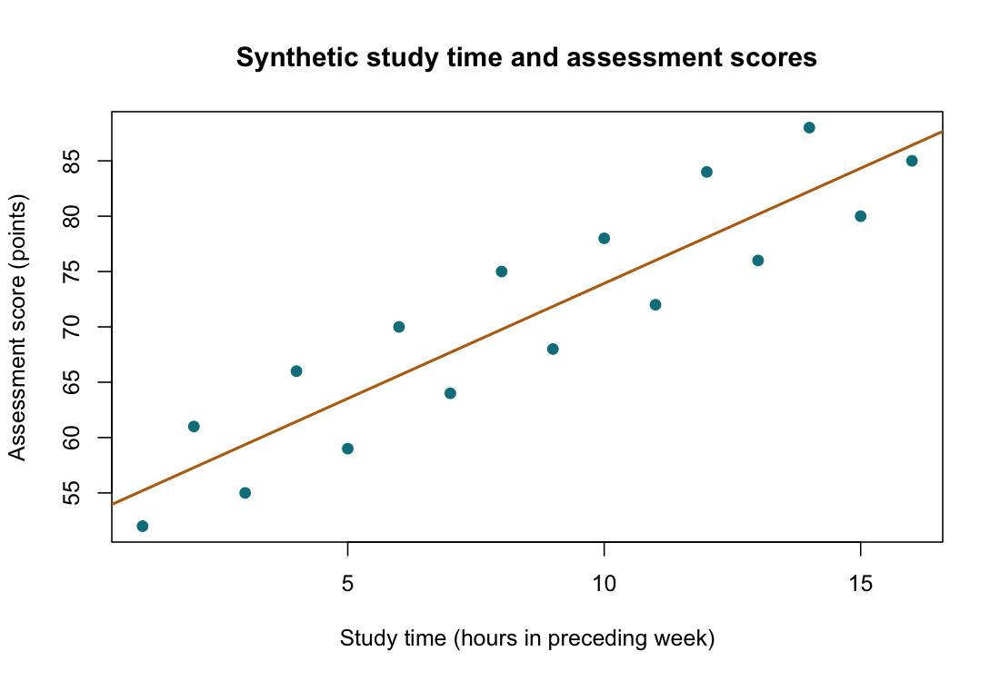

# Pearson Correlation

::: {.cdi-message}
- **ID:** STATS-016
- **Type:** Statistical method reference
- **Audience:** Beginner to intermediate learners, researchers, and analysts
- **Theme:** Estimate linear association between two numerical variables and explain uncertainty, influential observations, and limits on causal claims
:::

## 1. Your question

> How strongly are study hours and assessment scores linearly associated among learners?

The synthetic dataset contains 16 independent learners. Each row links one learner's study hours during the preceding week with their assessment score. These two measurements must remain together.

The target is the **population Pearson correlation**, written $\rho$. We estimate it using the sample correlation, $r$.

## 2. When to use this method

Pearson correlation summarizes the direction and strength of a linear relationship between two numerical variables with nonzero variation.

| Goal or design | Consider |
|---|---|
| Linear association between two numerical variables | Pearson correlation |
| Monotonic association using ranks | [Spearman correlation](17-spearman.qmd) |
| Change in outcome units per predictor unit | [Linear regression](18-linear-regression.qmd) |
| Repeated observations within participants | A method accounting for within-participant dependence |
| Agreement between two measurement methods | An agreement analysis; correlation alone is insufficient |

Computing a descriptive correlation does not require normally distributed data. The usual t-test and Fisher-transformed interval rely on additional inferential assumptions discussed below.

## 3. What it estimates or tests

The sample correlation is:

$$
r=\frac{\sum_i(x_i-\bar x)(y_i-\bar y)}
{\sqrt{\sum_i(x_i-\bar x)^2\sum_i(y_i-\bar y)^2}}.
$$

It ranges from -1 to +1. Positive values indicate that larger x values tend to accompany larger y values along a linear pattern; negative values indicate the reverse. Values near zero indicate weak linear association, but can coexist with a strong curved relationship.

Correlation is unitless and symmetric: swapping x and y leaves r unchanged. Changing hours to minutes also leaves it unchanged. Multiplying one variable by a negative constant reverses its sign.

For this two-sided test:

- **Null:** $H_0: \rho=0$.
- **Alternative:** $H_1: \rho\ne0$.

Under independent observations from a bivariate normal population, the statistic

$$
t=r\sqrt{\frac{n-2}{1-r^2}}
$$

has a t distribution with $n-2$ degrees of freedom under the null. Zero correlation is not generally equivalent to independence outside special models such as joint normality.

## 4. Check before running

### Keep the measurements aligned

A pair here means two variables measured on the same learner. That does not make the analysis a paired t-test: correlation examines association, whereas a paired t-test examines a mean difference on a meaningful common scale.

Check unique IDs, missing values, units, ranges, and row alignment. Never sort the two columns independently. If excluding incomplete records, document the number and reasons and consider possible missing-data bias.

### Inspect the scatterplot

Look for a roughly linear pattern, influential points, clusters, restricted ranges, and changes in spread. Separate groups can create a pooled correlation that differs substantially from within-group associations. Time trends can also produce misleading associations when observations are dependent.

Pearson's r can be strongly affected by one influential observation. Verify unusual values against source records; do not delete valid observations just to strengthen the correlation.

### Separate description from inference

The standard test assumes independent paired observations and a suitable joint distribution; bivariate normality is a standard sufficient condition for its exact null t calibration. Separate marginal normality checks do not establish joint normality.

The usual Fisher-z interval is approximate. With small samples, influential observations, or substantial nonnormality, its coverage and the test's calibration may be unreliable. A suitable bootstrap or other robust procedure needs assumptions matched to the sampling design; it is not an automatic repair.

## 5. Run the analysis

Copy these files into the repository root:

- [Synthetic study hours and scores](data/example/16-study-scores.csv)
- [Complete base R script](scripts/R/16-pearson.R)

```bash
Rscript scripts/R/16-pearson.R
```

The chapter code is non-executable display code. Run the actual script separately.

```r
# One row per learner, with both measurements aligned.
dat <- read.csv("data/example/16-study-scores.csv",
                stringsAsFactors = FALSE)
fit <- cor.test(dat$study_hours, dat$score, method = "pearson",
                alternative = "two.sided", conf.level = 0.95)
print(fit)
```

Inspect the relationship before interpreting the number:

```r
plot(dat$study_hours, dat$score,
     xlab = "Study time (hours in preceding week)",
     ylab = "Assessment score (points)")
abline(lm(score ~ study_hours, data = dat))
```

| Generated output | Contents |
|---|---|
| `results/tables/16-pearson.csv` | Correlation, approximate interval, t statistic, df, and p-value |
| `results/tables/16-leave-one-out.csv` | Descriptive correlation after omitting each learner in turn |
| `results/figures/16-study-score-scatter.png` | Scatterplot with an illustrative fitted straight line |

Outputs are generated by R and are not included as pre-generated results. Generate the files before rendering the figure references below.

{#fig-16-study-score-scatter width=100%}

## 6. Verify and explain the output

| Quantity | Expected value, rounded |
|---|---:|
| Independent learners | 16 |
| Pearson r | 0.91190 |
| Approximate 95% Fisher-z interval | 0.75952 to 0.96940 |
| t statistic | 8.31357 |
| Degrees of freedom | 14 |
| Two-sided p-value | 0.0000008729 |

Check that df equals $16-2=14$ and substitute r into the test-statistic formula. Swapping the variables should give the same r, p-value, and interval.

The sample shows a pronounced positive linear association. The interval estimates uncertainty about population correlation under the inferential model. It is not an interval containing 95% of score observations or predicted scores.

### How the interval is constructed

R's usual Pearson interval transforms the correlation using Fisher's z:

$$
z_r=\operatorname{atanh}(r),\qquad SE(z_r)\approx\frac{1}{\sqrt{n-3}}.
$$

Calculate an approximate normal interval on that scale and transform its limits back using the hyperbolic tangent. This keeps the interval within the correlation range. It does not make the interval exact.

### Sensitivity checks

The script calculates r after omitting each learner in turn. Inspect whether a single omission changes the interpretation substantially. This is a diagnostic aid, not permission to select the omission producing the preferred result. Report consequential sensitivity and investigate the underlying observation.

### Correlation is not a slope, agreement, or causation

An r of 0.912 does not mean each additional hour adds 0.912 score points. A regression slope answers that units-based question.

Two devices can correlate almost perfectly while one consistently reads ten units higher; correlation does not establish agreement.

The association between study hours and scores could reflect prior ability, motivation, access to resources, or other factors. A small p-value does not establish that increasing study hours causes higher scores.

In simple ordinary least-squares regression with an intercept using these same complete observations, $r^2$ equals the model's sample R-squared. This special identity does not establish a causal percentage explained and should not be generalized to arbitrary models.

## 7. Use AI and check its suggestions

> Analyze the supplied synthetic study hours and scores using two-sided Pearson correlation. Preserve row matching and inspect the scatterplot for curvature, groups, and influential observations. Report n, r, the approximate Fisher-z confidence interval, and the usual t-test result, with its distributional assumptions. Distinguish correlation from slope, agreement, and causation. Use leave-one-out calculations only as sensitivity diagnostics, not to choose exclusions.

Verify n=16, df=14, positive r about 0.9119, the stated interval method, and the absence of unsupported claims about points gained per hour. Ask what study design would be needed to support a causal claim.

## 8. Report your finding

> In 16 synthetic learner observations, study hours and assessment scores showed a positive linear association, Pearson r=0.912 (approximate Fisher-z 95% CI 0.760 to 0.969), t(14)=8.31, p=0.000000873. Inference assumes independent observations and an appropriate joint distribution. The association does not establish a causal effect of study time, and the small sample limits assessment of influential observations and distributional assumptions.

For an applied report, describe sampling, missingness, the scatterplot, relevant sensitivity checks, and potential confounding.

## 9. Common mistakes and alternatives

| Mistake | Better approach |
|---|---|
| Reporting r without a scatterplot | Inspect shape, subgroups, and influential observations |
| Treating r near zero as no relationship | Check for nonlinear patterns |
| Reading r as a score-per-hour slope | Use an appropriately specified regression model |
| Selecting exclusions to improve r | Verify observations and report justified sensitivity analyses |
| Treating repeated visits as independent learners | Use a method reflecting the dependence |
| Treating a high r as agreement or causation | Match the method to the actual question |

Spearman correlation may suit a monotonic rank-based question, but it does not remove confounding or clustering and can also miss nonmonotonic structure. Regression supports units-based effects and adjustment under a specified model. More complex designs require methods appropriate to their sampling and dependence.

## 10. Check your understanding

An AI report says: “r=0.912, so an extra study hour improves the score by 0.912 points.”

What should be corrected?

::: {.callout-note collapse="true"}
## Check your reasoning
Correlation is unitless and does not give a slope in points per hour. Estimate a regression slope for a units-based association. Even that slope does not establish improvement caused by additional study without suitable design and assumptions.
:::

## Next step

Continue to [Spearman Correlation](17-spearman.qmd) for a monotonic association measured using ranks.
