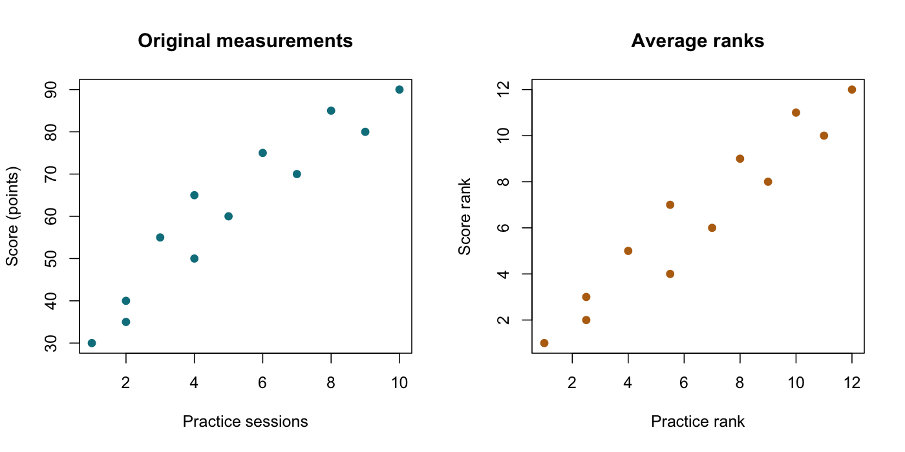

# Spearman Correlation

::: {.cdi-message}
- **ID:** STATS-017
- **Type:** Statistical method reference
- **Audience:** Beginner to intermediate learners, researchers, and analysts
- **Theme:** Estimate monotonic association using ranks, handle ties explicitly, and distinguish the coefficient from its inferential assumptions
:::

## 1. Your question

> Do learners with more practice sessions tend to have higher assessment scores?

Twelve independent synthetic learners each contribute a practice-session count and a score. Two learners report two sessions, and two report four sessions. These repeated values are **ties**, not duplicate participants.

The target is a rank-based association between practice and score. It is not a score increase per session or a causal effect of practice.

## 2. When to use this method

Spearman correlation is Pearson correlation calculated on the ranks of two variables. It describes monotonic association: as one variable increases, the other tends consistently upward or downward, without requiring a straight-line relationship on the original scale.

| Question | Consider |
|---|---|
| Monotonic association for numerical or ordered variables | Spearman correlation |
| Linear association on original numerical scales | [Pearson correlation](16-pearson.qmd) |
| Outcome change in units per predictor unit | [Linear regression](18-linear-regression.qmd), with an appropriate model |
| Agreement between measurements | An agreement method, not correlation alone |

Monotonic does not mean every observation must follow the same ordering. Sampling variation and measurement noise can produce reversals.

Spearman can miss strong nonmonotonic relationships, such as a U-shaped pattern. It does not automatically solve clustering, confounding, missing-data bias, or influential observations.

## 3. What it estimates or tests

The sample coefficient is:

$$
r_s=\operatorname{cor}(\operatorname{rank}(X),\operatorname{rank}(Y)).
$$

Assign average ranks to tied values. The coefficient ranges from -1 to +1 when both rank vectors have nonzero variation. It is unitless and unchanged when the variables are swapped.

For continuous variables, population Spearman correlation can be defined as the correlation between their population cumulative-distribution transforms. With discrete or ordered variables, tie conventions matter to the corresponding rank-based target.

The conventional two-sided test is described as testing zero population Spearman correlation against a nonzero value. Its p-value calibration requires suitable independent observations and distributional or null assumptions. Exact permutation calibration is justified under an independence/exchangeability null; zero rank correlation alone is not equivalent to independence and does not justify arbitrary permutation under every dependent distribution.

### A shortcut with limits

Without ties, the familiar identity is:

$$
r_s=1-\frac{6\sum_i d_i^2}{n(n^2-1)},
$$

where $d_i$ is the difference between each observation's two ranks. Do not apply this shortcut unchanged to tied data. Compute Pearson correlation of the average ranks instead.

## 4. Check before running

Verify IDs and row alignment, meaningful ordering, missing values, and nonconstant variables. Never independently sort the two columns. A learner's practice count must remain linked to that learner's score.

Inspect a scatterplot on the original scales. Look for monotonic patterns, subgroups, ceiling effects, restricted ranges, and influential observations. A rank plot can help reveal how the coefficient arises, but it does not replace the original-scale plot.

Rank-based measures require meaningful order, not equal intervals between ordinal categories. Code category order explicitly and justify it. For example, alphabetical ordering of Low, Medium, High would give the wrong ranks.

Many ties reduce the available ordering information and can affect attainable correlations and inference. Constant variables make the coefficient undefined. Missing values require an explicit strategy; complete-pair deletion can bias the analysis when missingness is informative.

## 5. Run the analysis

Copy the supplied files into the repository root:

- [Synthetic practice and score data](data/example/17-practice-scores.csv)
- [Complete base R script](scripts/R/17-spearman.R)

```bash
Rscript scripts/R/17-spearman.R
```

All code blocks here are non-executable displays. The actual calculations and exports are in the script.

```r
# Tied counts are handled using average ranks.
dat <- read.csv("data/example/17-practice-scores.csv",
                stringsAsFactors = FALSE)
fit <- cor.test(dat$practice_sessions, dat$score, method = "spearman",
                alternative = "two.sided", exact = FALSE, continuity = FALSE)
print(fit)
```

Verify the coefficient directly:

```r
practice_rank <- rank(dat$practice_sessions, ties.method = "average")
score_rank <- rank(dat$score, ties.method = "average")
cor(practice_rank, score_rank, method = "pearson")
```

The script exports `results/tables/17-spearman.csv`, `results/tables/17-ranks.csv`, and `results/figures/17-spearman-scatter.png`. These are generated by R, not by Quarto. Generate the figure file before rendering this chapter.

### P-value settings

We explicitly use `exact = FALSE` and `continuity = FALSE` because this example has ties and uses R's asymptotic t approximation. The coefficient is calculated from ranks; the small p-value is an **approximation**, not an exact permutation result.

At n=12, approximation quality needs caution even when the numerical result looks decisive. For a small applied study, consider a suitable permutation calculation under a defensible independence null. Preserve pairs while permuting one variable relative to the other, and respect any sampling or design restrictions. Report simulation settings and uncertainty if the permutation distribution is sampled rather than fully enumerated.

{#fig-17-spearman-scatter width=100%}

## 6. Verify and explain the output

The practice values are:

**1, 2, 2, 3, 4, 4, 5, 6, 7, 8, 9, 10.**

Their average ranks are:

**1, 2.5, 2.5, 4, 5.5, 5.5, 7, 8, 9, 10, 11, 12.**

The tied twos occupy ranks 2 and 3, giving each rank 2.5. The tied fours occupy ranks 5 and 6, giving each rank 5.5.

| Quantity | Expected value, rounded |
|---|---:|
| Independent learners | 12 |
| Spearman coefficient | 0.961409 |
| Asymptotic two-sided p-value, no continuity correction | 0.0000006317 |

The sample shows a pronounced positive rank association. Learners with more sessions tend to have higher scores. That does not establish a particular score gain per session or that all learner pairs follow the pattern.

Base R may print a statistic labeled **S**. With ties, do not automatically interpret that number as the uncorrected sum of squared rank differences from the no-ties shortcut. Verify the coefficient from the actual average ranks and record the software's calculation convention.

### Confidence intervals

Base R's `cor.test()` does not provide a Spearman confidence interval in this example. Do not copy a Pearson Fisher-z interval and label it as a Spearman interval without justification.

A suitable paired-observation bootstrap can estimate uncertainty under independent sampling, but small samples, ties, and degenerate resamples complicate coverage. This introductory script does not implement an interval. Report that limitation rather than inventing precision from the p-value.

### Read the generated figure

The first panel shows sessions and scores in their original units. The second shows average ranks. Tied counts produce shared horizontal ranks. Interpret the original-scale pattern alongside the coefficient; the rank plot alone cannot reveal the practical size of score differences.

## 7. Use AI and check its suggestions

> Calculate Spearman correlation from the supplied 12 synthetic learners, preserving row alignment. Show average ranks for tied practice counts and verify the coefficient as Pearson correlation of those ranks. Use and label the specified asymptotic p-value without continuity correction. Explain the small-sample limitation, why a no-ties shortcut is unsuitable, and why an independence permutation null differs from only zero correlation. Do not invent a confidence interval or a causal score gain per session.

Check n=12, ranks 2.5 and 5.5 for the tied values, a positive coefficient near 0.9614, and explicit labeling of the approximate p-value. A response claiming an exact result despite the specified approximation needs correction.

## 8. Report your finding

> Among 12 synthetic independent learner observations, practice-session counts and assessment scores showed a positive rank association, Spearman r_s=0.961. Using average ranks for ties and an asymptotic two-sided test without continuity correction gave approximate p=0.000000632. No confidence interval was calculated. The small sample and tied practice counts limit inferential precision, and the association does not establish a causal effect of practice.

For an applied report, add sampling, missing-data handling, the observed plot pattern, subgroup structure, and a justified uncertainty procedure when available.

## 9. Common mistakes and alternatives

| Mistake | Better approach |
|---|---|
| Applying the no-ties shortcut unchanged | Correlate average ranks |
| Ranking ordinal categories alphabetically | Define their meaningful order |
| Treating nonparametric as assumption-free | Check independence, ordering, and inferential calibration |
| Calling the asymptotic p-value exact | State the actual calculation |
| Concluding no relationship from r_s near zero | Inspect for nonmonotonic patterns |
| Calling the coefficient points per session | Use a suitable regression model for a units-based question |

Kendall's tau is another rank-based association measure with its own interpretation and tie handling. Regression can address a conditional relationship or adjustment variables under a specified model. Repeated measurements need dependence-aware methods; ranks alone do not provide that adjustment.

## 10. Check your understanding

An AI tool ranks two tied practice counts as 2 and 3, based on their row order, then calculates Spearman correlation.

What should change?

::: {.callout-note collapse="true"}
## Check your reasoning
Equal values should receive the same average rank, 2.5, for the standard Spearman calculation. Breaking ties by arbitrary row order introduces unsupported ordering and can change the coefficient. Preserve the pairing and correlate the average-rank vectors.
:::

## Next step

Continue to [Linear Regression](18-linear-regression.qmd) to estimate relationships in outcome units and introduce adjustment for additional predictors.
