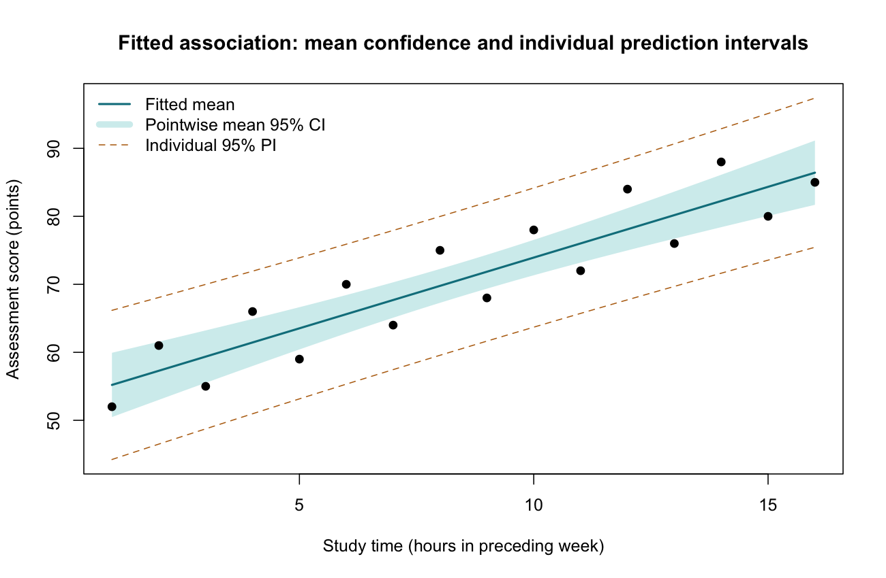
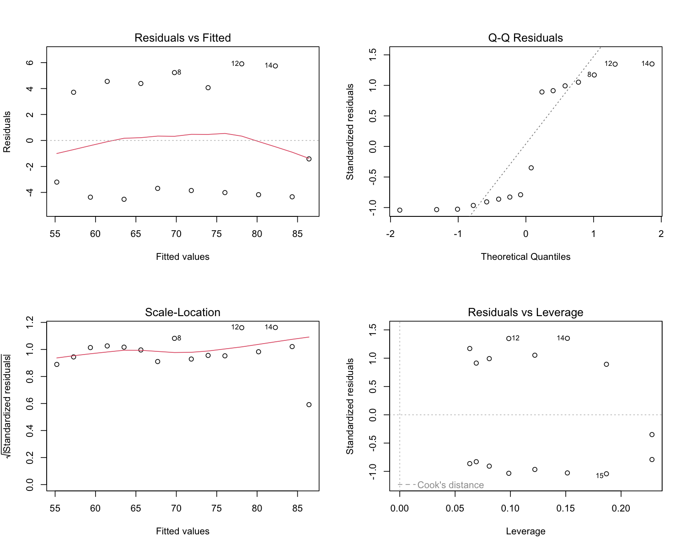

# Linear Regression

::: {.cdi-message}
- **ID:** STATS-018
- **Type:** Statistical method reference
- **Audience:** Beginner to intermediate learners, researchers, and analysts
- **Theme:** Estimate numerical outcome relationships in meaningful units, assess model assumptions, and distinguish association from prediction and causation
:::

## 1. Your question

> How does the mean assessment score relate to study hours during the preceding week?

This example reuses Chapter 16's 16 synthetic learners, with a separate chapter-specific input file. Each row contains one independent learner's study hours and score.

Pearson correlation summarized the linear association without units. Regression estimates a **slope in score points per study hour**. We begin with one predictor, then explain how adjustment changes interpretation.

## 2. When to use this method

Linear regression models a numerical outcome's conditional mean as a function of one or more predictors. Predictors can be numerical or categorical when coded appropriately.

Use it for a units-based association or prediction question when the mean structure and error assumptions are defensible. Repeated observations, clustering, binary outcomes, and time dependence generally need a suitable extension or another model.

A bounded score is numerical, but linear predictions can extend outside its permitted range. Assess whether the model is appropriate within the range used, especially near boundaries.

## 3. What it estimates or tests

For one predictor:

$$
Y_i=\beta_0+\beta_1X_i+\varepsilon_i.
$$

The model assumes the conditional mean is $E(Y\mid X)=\beta_0+\beta_1X$, with errors having mean zero conditional on X.

- **Intercept, $\beta_0$:** Expected score at zero study hours, if that value is meaningful and the model applies there.
- **Slope, $\beta_1$:** Difference in expected score associated with one additional study hour.
- **Slope null:** $H_0:\beta_1=0$ in the specified model.

Ordinary least squares chooses coefficients that minimize the sum of squared residuals. A residual is observed score minus fitted score.

The slope is an association parameter. Calling it an effect requires additional causal assumptions and design support.

## 4. Check before running

| Condition | What to inspect |
|---|---|
| Independent errors | Sampling, clustering, repeated visits, and time ordering |
| Appropriate mean structure | Scatterplot, residual patterns, possible curves and interactions |
| Consistent measurement | Units, missingness, ranges, and row matching |
| Constant error variance for conventional SEs | Residual spread across fitted values |
| Error distribution for exact small-sample t inference | Residual Q-Q plot and influential observations |
| Identifiable predictors | No exact linear redundancy; inspect strong collinearity in larger models |

Predictors do not need to be normally distributed. Normal-error assumptions concern the conditional outcome errors, not the marginal distribution of X. Residual checks provide imperfect evidence, especially with small samples.

Heteroscedasticity-robust SEs may support inference under suitable conditions when variance is not constant, but they do not correct a wrong mean structure, dependence, or confounding. They are not implemented in this base R example.

### Influence is not an exclusion rule

Leverage identifies unusual predictor configurations. Residuals describe discrepancies from fitted values. Cook's distance summarizes influence on the fitted coefficients. Investigate unusual cases and report meaningful sensitivity analyses; never automatically remove valid observations to improve model fit or significance.

## 5. Run the analysis

Copy these files into the repository root:

- [Synthetic study and score data](data/example/18-study-scores.csv)
- [Complete base R script](scripts/R/18-linear-regression.R)

```bash
Rscript scripts/R/18-linear-regression.R
```

All code blocks are non-executable displays. The actual analysis and plot generation are in the script.

```r
# Estimate an association in score points per study hour.
dat <- read.csv("data/example/18-study-scores.csv",
                stringsAsFactors = FALSE)
fit <- lm(score ~ study_hours, data = dat)
summary(fit)
confint(fit)
```

The script exports coefficient estimates and intervals, model summaries, observation diagnostics, prediction tables, and two figures under `results/figures/`: `18-regression-intervals.png` and `18-regression-diagnostics.png`.

These files are generated when you run R. Pre-generated R outputs are not included; generate the files before rendering this chapter.

{#fig-18-regression-intervals width=100%}

{#fig-18-regression-diagnostics width=100%}

## 6. Verify and explain the output

| Quantity | Expected value, rounded |
|---|---:|
| Learners | 16 |
| Residual degrees of freedom | 14 |
| Intercept | 53.125 points |
| Intercept 95% CI | 47.934 to 58.316 points |
| Slope | 2.08088 points per hour |
| Slope 95% CI | 1.54404 to 2.61772 points per hour |
| Slope two-sided p-value | 0.0000008729 |
| Sample R-squared | 0.83156 |

The fitted equation is:

$$
\widehat{\text{score}}=53.125+2.08088\times\text{study hours}.
$$

At eight hours, the fitted mean is approximately 69.77 points. The slope indicates that one additional hour is associated with approximately 2.08 higher expected score points under the fitted model.

Study hours range from 1 to 16. The intercept concerns zero hours, which is outside that observed range; interpret it cautiously. Do not extrapolate the line indefinitely or assume score increases remain linear up to and beyond the score ceiling.

The slope interval is for the population association parameter under the model. It is not a range of individual improvements caused by another hour of study.

### R-squared

The sample R-squared of about 0.832 means the fitted line accounts for about 83.2% of the observed score sum-of-squares variation around the sample mean. It does not establish that study time causes 83.2% of score variation or that predictions will perform equally well on new learners.

In this simple regression with an intercept, R-squared equals the square of Pearson r from the same complete observations. Adding predictors can increase in-sample R-squared even when they offer little predictive value. Adjusted R-squared does not replace validation on appropriate held-out data.

## 7. Confidence intervals versus prediction intervals

A confidence interval describes uncertainty about the **conditional mean score** at a specified predictor value. A prediction interval describes uncertainty about a **new individual score**, including individual variation as well as estimation uncertainty.

```r
new_learner <- data.frame(study_hours = 8)
predict(fit, newdata = new_learner, interval = "confidence")
predict(fit, newdata = new_learner, interval = "prediction")
```

The prediction interval is wider under the same model because a new learner may differ from the population mean. Both depend on the model assumptions and relevant predictor range. Neither describes a causal benefit from intervening on study hours.

The script's grid uses observed study-hour limits. Its mean intervals are **pointwise**, not a simultaneous confidence band for the entire line. The dashed prediction limits are also pointwise intervals, not guaranteed coverage for every future learner simultaneously.

## 8. Adjusted associations and model specification

If prior score were measured before the study period, a prespecified model might be:

```r
# Conceptual example only: prior_score is not in this chapter's dataset.
# adjusted <- lm(score ~ study_hours + prior_score, data = dat)
```

The study-hours coefficient would then describe its association with expected score **holding prior score constant**, under an additive linear model. Adjustment can change both the estimate and its uncertainty.

Choose covariates using the question, timing, and subject knowledge. Adding every available variable is not a general solution: adjusting for mediators or colliders can change the target or introduce bias. Collinearity can make individual coefficients unstable. An interaction means the slope depends on another variable, so a single common slope may be inappropriate.

This chapter's runnable example fits only the one-predictor model. It does not claim to have controlled for prior ability or motivation.

## 9. Read the diagnostic figures

- **Residuals versus fitted:** Look for systematic curvature and changing spread.
- **Normal Q-Q:** Inspect departures from the normal-error approximation, especially tails.
- **Scale-location:** Examine whether residual variability changes across fitted values.
- **Residuals versus leverage:** Identify observations that may influence the fitted relationship.

Good-looking diagnostics cannot prove the model is correct or causal. Record important findings and explain how they affect inference. With n=16, avoid overconfidence in the apparent pattern.

## 10. Use AI and check its suggestions

> Fit the supplied synthetic data using score as the outcome and study_hours as the predictor. Report the slope in score points per hour with its conventional 95% t interval, sample size, residual df, and R-squared. Inspect residual patterns, leverage, and influence. Explain mean confidence versus individual prediction intervals at eight hours. State that no covariates are available for adjustment and do not claim that extra study causes improvement.

Check formula direction, units, n=16, residual df=14, slope approximately 2.0809, and the interval type. If a response says the model adjusted for prior ability, ask which measured variable supports that claim; none is included here.

## 11. Report your finding

> In 16 synthetic learners, a simple linear regression estimated a positive association between study hours and assessment scores: 2.08 score points per additional hour (95% CI 1.54 to 2.62; two-sided p=0.000000873). The model's sample R-squared was 0.832. Conventional inference assumes an appropriate linear mean structure and independent, normally distributed errors with constant variance. The model was unadjusted, and the association does not establish a causal study-time effect.

For applied reporting, add recruitment, missingness, diagnostic findings, model specification, sensitivity checks, and the intended scope of prediction or inference.

## 12. Common mistakes and alternatives

| Mistake | Better approach |
|---|---|
| Treating a regression slope as automatically causal | Assess design, timing, and confounding |
| Requiring normally distributed predictors | Check conditional errors and mean structure |
| Treating high R-squared as model validation | Inspect diagnostics and validate predictions appropriately |
| Using mean confidence limits for individual prediction | Request a prediction interval |
| Extrapolating beyond observed support | Restrict conclusions or justify the extrapolation |
| Adding variables solely to improve p-values | Prespecify a defensible model and record exploratory changes |

Consider transformations or nonlinear terms for an appropriate revised mean structure, robust inference where justified, mixed models for clustering, and generalized linear models for outcomes with different distributions. Each changes assumptions and possibly interpretation.

## 13. Check your understanding

An AI report gives a narrow 95% interval for the expected mean score at eight study hours and says every new learner should fall within it.

What should change?

::: {.callout-note collapse="true"}
## Check your reasoning
A mean confidence interval concerns the conditional population mean, not individual scores. A prediction interval accounts for new individual variation and is wider under the same model. Even a 95% prediction interval does not guarantee every learner will fall inside it.
:::

## Next step

Continue to [Logistic Regression](19-logistic-regression.qmd) to model a binary outcome using predicted probabilities and odds ratios.
