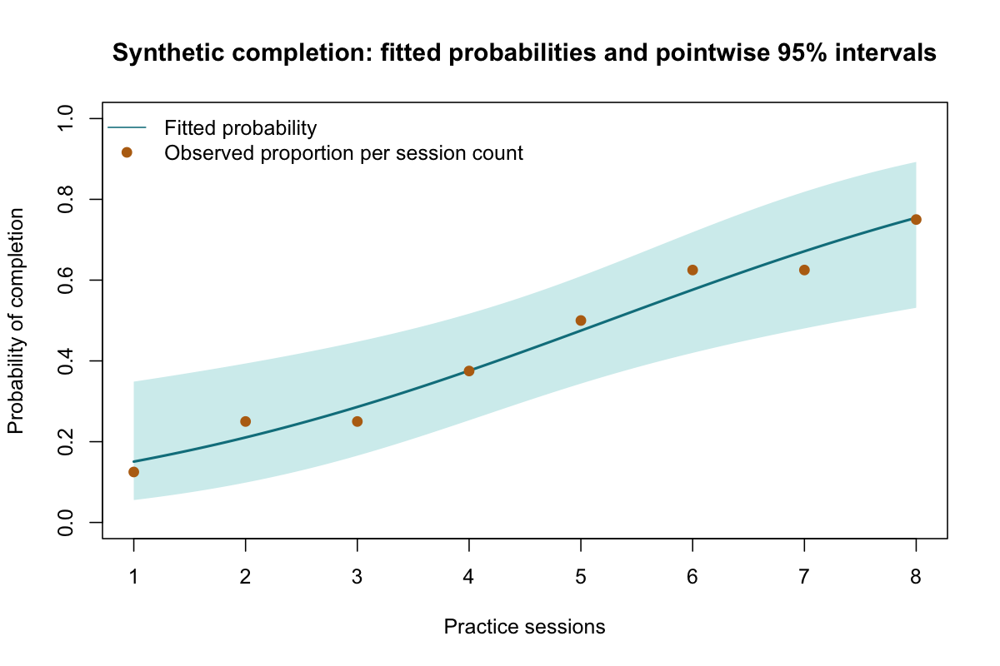

# Logistic Regression

::: {.cdi-message}
- **ID:** STATS-019
- **Type:** Statistical method reference
- **Audience:** Beginner to intermediate learners, researchers, and analysts
- **Theme:** Model a binary outcome using log odds, interpret odds ratios and predicted probabilities, and assess uncertainty and model limitations
:::

## 1. Your question

> How is the probability of task completion associated with the number of practice sessions?

The dataset contains 64 independent synthetic learners. The outcome is coded **1 for completed** and **0 for not completed**. Practice sessions range from one to eight.

| Sessions | Learners | Completed |
|---|---:|---:|
| 1 | 8 | 1 |
| 2 | 8 | 2 |
| 3 | 8 | 2 |
| 4 | 8 | 3 |
| 5 | 8 | 4 |
| 6 | 8 | 5 |
| 7 | 8 | 5 |
| 8 | 8 | 6 |

Unlike Chapter 18's numerical score outcome, this outcome has only two values. Logistic regression keeps fitted probabilities between zero and one.

## 2. When to use this method

Use binary logistic regression to model the conditional probability of a defined event using numerical or categorical predictors. Each observation's outcome and predictors must be correctly aligned.

Independent Bernoulli observations are assumed in this example. Repeated outcomes, matched designs, clustered samples, and complex surveys need appropriate extensions or design-based methods. Counts, survival times, and unordered outcomes with several categories require other models.

Define whether the goal is describing an association, estimating an adjusted relationship, or predicting outcomes for new individuals. These goals require different choices about design, covariates, and validation.

## 3. What it estimates or tests

If p is completion probability, its odds are $p/(1-p)$. Logistic regression models log odds:

$$
\log\left(\frac{p}{1-p}\right)=\beta_0+\beta_1X.
$$

The probability follows from the inverse-logit transformation:

$$
p=\frac{1}{1+\exp[-(\beta_0+\beta_1X)]}.
$$

For one additional session, $\exp(\beta_1)$ is the modeled **completion odds ratio**, assuming a constant slope on the log-odds scale.

- **Slope null:** $\beta_1=0$, equivalent to an odds ratio of one.
- **Two-sided alternative:** The slope differs from zero.

The script uses maximum-likelihood estimation and conventional asymptotic Wald inference. These calculations can be unreliable with sparse information, separation, or model misspecification.

## 4. Check before running

| Check | What to establish |
|---|---|
| Event coding | Completed is explicitly numeric 1; not completed is 0 |
| Independence | One independent learner per row, with clustering addressed if present |
| Missingness | Missing outcomes and predictors are investigated |
| Mean structure | Numerical predictor relationship is appropriate on the log-odds scale |
| Information | Enough events and non-events across predictor patterns for stable estimation |
| Separation | Predictor patterns do not perfectly or nearly determine the outcome |
| Influence and redundancy | Investigate influential cases and collinearity in larger models |

Neither predictors nor binary outcomes need to be normally distributed. The linearity assumption concerns **log odds**, not a straight line in probability. Curves, transformations, or interactions may be needed for a suitable model.

### Separation and convergence

Complete or quasi-complete separation can drive ordinary maximum-likelihood coefficients toward infinity. Warning signs include huge coefficients or standard errors, fitted probabilities near zero or one, and convergence warnings. Successful convergence alone does not guarantee stable estimates.

Do not ignore warnings or remove observations to manufacture convergence. Reconsider coding, information, and model complexity; suitable penalized or bias-reduced methods may be needed. No single events-per-variable rule guarantees an adequate model.

## 5. Run the analysis

Copy the supplied files into your repository root:

- [Synthetic individual outcomes](data/example/19-practice-completion.csv)
- [Complete base R script](scripts/R/19-logistic-regression.R)

```bash
Rscript scripts/R/19-logistic-regression.R
```

All chapter code blocks are non-executable displays. Run the standalone script for the actual analysis and exports.

```r
# Model the probability of completed=1.
dat <- read.csv("data/example/19-practice-completion.csv",
                stringsAsFactors = FALSE)
fit <- glm(completed ~ practice_sessions, data = dat,
           family = binomial(link = "logit"))
summary(fit)
```

Exponentiate coefficients and explicitly selected Wald intervals:

```r
exp(coef(fit))
exp(confint.default(fit))  # Conventional asymptotic Wald intervals.
```

`confint.default()` is used deliberately. Other interval methods, including profile likelihood, can produce different limits and should be named accordingly.

The script exports coefficient estimates, predicted probabilities, and observation diagnostics under `results/tables/`, plus `results/figures/19-probability-curve.png`. These outputs are generated when R runs; pre-generated R results are not included or needed to render the chapter.

{#fig-19-probability-curve width=100%}

## 6. Verify and explain the output

| Quantity | Expected value, rounded |
|---|---:|
| Learners | 64 |
| Completed events | 28 |
| Non-events | 36 |
| Intercept | -2.13662 |
| Session coefficient, log-odds scale | 0.407315 |
| Odds ratio per additional session | 1.50278 |
| Wald 95% odds-ratio interval | 1.16251 to 1.94264 |
| Two-sided Wald p-value for slope | 0.001874 |
| Fitted completion probability at four sessions | 0.37581 |

Numerical optimization can change final digits slightly. Verify that $\exp(0.407315)\approx1.50278$.

Under this model, one additional session is associated with about **50.3% higher completion odds**. That is not 50.3 percentage points higher probability, and it is not necessarily a 50.3% higher probability.

At four sessions:

$$
\eta=-2.13662+0.407315(4)\approx-0.50736,
$$

so $p=1/(1+\exp[-\eta])\approx0.37581$.

A constant odds ratio does not imply a constant probability difference. The probability change depends on the starting predictor value and any other covariates in the model.

### Intercept and outcome reversal

The intercept describes log odds at zero sessions, outside the observed range of one to eight. Interpret it cautiously. Recoding the event from completed to not completed reverses coefficient signs and reciprocates odds ratios. Confirm the modeled event before explaining results.

## 7. Predicted probabilities and uncertainty

```r
predict(fit, newdata = data.frame(practice_sessions = 4), type = "response")
```

The script calculates approximate pointwise Wald intervals on the log-odds scale and transforms the limits back to probabilities. Transforming on that scale keeps limits between zero and one.

The interval concerns uncertainty about the modeled conditional event probability. It is not an individual-outcome interval like the numerical prediction interval in linear regression: a new learner's observed binary outcome is either zero or one.

In the generated plot, the curve and shaded interval represent the model, while points show observed proportions among the eight learners at each session count. The shaded region is pointwise, not a simultaneous band.

## 8. Adjustment and interpretation

With additional prespecified predictors, the session odds ratio would be conditional on those variables under the specified model. For example, prior experience could be relevant if appropriately measured before practice.

This dataset includes no adjustment variables. The runnable model is **unadjusted** and cannot support claims that it accounts for prior ability or motivation.

Choose covariates using the question, timing, and causal reasoning. Do not add every available variable or select solely by p-values. Logistic odds ratios are noncollapsible: adjusted and unadjusted odds ratios can differ even without confounding. A changed odds ratio alone does not prove that a variable was a confounder.

## 9. Model checking and prediction performance

Inspect outcome counts across predictor values, plausible nonlinear patterns, residuals, leverage, and influence. Binary residuals do not behave like normal linear-regression residuals; do not require a normal residual Q-Q plot as a logistic assumption check.

A converged model and a small slope p-value do not establish predictive quality. For prediction, assess calibration and discrimination using appropriate validation, while preventing information leakage. An AUC alone does not establish well-calibrated probabilities, and a 0.5 classification threshold is not universally appropriate.

This teaching script fits the model and exports basic diagnostics. It does not perform external validation, a full calibration assessment, separation detection, or automated model selection.

## 10. Use AI and check its suggestions

> Fit the supplied synthetic binary outcomes using completed=1 as the event and practice_sessions as the predictor. Report the log-odds slope, odds ratio per session, conventional Wald interval, and predicted probability at four sessions. Check coding, dependence, sparse information, separation, and logit linearity. State that the model is unadjusted. Distinguish higher odds from probability changes and distinguish probability uncertainty from an individual binary outcome.

Verify n=64, 28 events, positive slope near 0.4073, odds ratio near 1.503, and probability near 0.3758 at four sessions. Correct any claim that the odds ratio gives an equal probability increase at every predictor value.

## 11. Report your finding

> In 64 synthetic learners, including 28 completed outcomes, an unadjusted logistic model estimated higher completion odds with more practice sessions: odds ratio 1.50 per session (conventional Wald 95% CI 1.16 to 1.94; two-sided p=0.00187). The fitted completion probability at four sessions was approximately 37.6%. Interpretation assumes an appropriate logit relationship and independent outcomes. The association does not establish a causal practice effect, and predictive performance has not been validated.

For applied reporting, add sampling, missingness, event coding, adjustment variables, functional forms, diagnostics, interval method, and relevant validation results.

## 12. Common mistakes and alternatives

| Mistake | Better approach |
|---|---|
| Reversing event coding without changing interpretation | State which outcome is modeled |
| Calling an odds ratio a probability ratio | Explain odds and report probabilities where useful |
| Assuming a constant probability difference | Calculate probabilities at relevant predictor values |
| Ignoring separation warnings | Investigate and use an appropriate estimation strategy |
| Requiring normal binary residuals | Use diagnostics appropriate to a binomial model |
| Calling fitted probabilities validated predictions | Evaluate performance with appropriate held-out information |

Use appropriate extensions for clustering or repeated binary outcomes, and alternative link functions or models when the target is a risk difference or ratio. Penalized or bias-reduced estimation may help with sparse data but changes the procedure and must be documented.

## 13. Check your understanding

An AI report says: “The odds ratio is 1.50, so every extra session adds 50 percentage points to completion probability.”

What should it say?

::: {.callout-note collapse="true"}
## Check your reasoning
The model estimates approximately 50% higher odds per session, not a fixed probability increase. Convert the linear predictor to probabilities at specified session values to explain probability differences. These remain associations unless the design and assumptions support a causal interpretation.
:::

## Next step

Continue to [Bootstrap and Permutation Methods](20-resampling.qmd) to explore uncertainty estimation and null testing through resampling.
