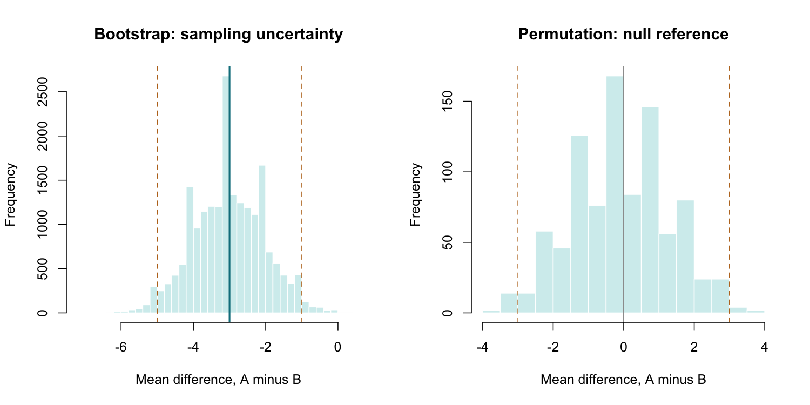

# Bootstrap and Permutation Methods

::: {.cdi-message}
- **ID:** STATS-020
- **Type:** Statistical method reference
- **Audience:** Beginner to intermediate learners, researchers, and analysts
- **Theme:** Use resampling to estimate uncertainty or construct a null reference distribution while preserving the study design
:::

## 1. Your question

> What is the mean outcome difference between independent groups A and B, and how uncertain is it?

A second question asks whether the observed difference is unusual under a null model that permits group labels to be exchanged.

| Group | Synthetic outcomes | Mean |
|---|---|---:|
| A | 4, 5, 6, 7, 8, 9 | 6.5 |
| B | 7, 8, 9, 10, 11, 12 | 9.5 |

The observed difference, **A minus B**, is -3 outcome units. Each group contains six independent participants. This deliberately small dataset allows complete permutation enumeration, but also makes bootstrap inference fragile.

## 2. Two procedures, different purposes

| Method | What changes? | Main purpose in this chapter |
|---|---|---|
| Bootstrap | Sample observations with replacement within each original group | Approximate sampling uncertainty of the mean difference |
| Permutation | Reallocate labels without replacement, preserving group sizes | Construct a null reference distribution |

A bootstrap distribution is usually centered near the observed estimate. A null permutation distribution is centered near the null value for this symmetric allocation design. Do not interpret one as the other.

Neither method creates new independent information or repairs a biased sample. More resamples reduce simulation error, not the uncertainty caused by limited original data.

## 3. Bootstrap uncertainty

For each bootstrap replicate:

1. Sample six A observations with replacement from A.
2. Independently sample six B observations with replacement from B.
3. Calculate the resampled mean A minus resampled mean B.

Repeat 19,999 times. The SD of those differences estimates the estimator's SE. A **percentile interval** uses the 2.5th and 97.5th percentiles of the bootstrap estimates.

This is an approximate procedure, not an exact 95% guarantee. Small samples, bias, skewness, heavy tails, nonsmooth statistics, and boundary estimates can impair coverage. BCa, basic, and bootstrap-t intervals use different constructions and assumptions; do not call them interchangeable.

Resampling within groups preserves the two-group sampling structure without assuming their distributions are equal. Pooling before bootstrapping would change the procedure and its target uncertainty.

## 4. Permutation null and exchangeability

The simple label-permutation procedure pools all 12 outcomes, selects six participant indices for A, and assigns the remaining six to B. There are:

$$
\binom{12}{6}=924
$$

possible allocations. Recalculate the difference for each allocation.

Under independent sampling from identical group distributions, labels are exchangeable under the null. Under an appropriate completely randomized assignment, the same allocation logic can provide a randomization test of a sharp no-effect null. State which justification applies to the actual study.

**Equality of means alone does not generally justify unstudentized label permutation when distributions differ**, such as unequal variances. A suitably studentized procedure can have useful asymptotic properties under weaker nulls, but is a different method and is not implemented here.

This example uses the absolute mean difference as its two-sided extremeness rule. All allocations with an absolute difference at least 3 count as extreme.

## 5. Match resampling to the design

| Data structure | Design-aware consideration |
|---|---|
| Independent two-group observations | Bootstrap within groups; justify null label exchangeability |
| Paired outcomes | Bootstrap complete pairs; do not independently resample the two paired columns |
| Clustered participants | Resample independent clusters with an appropriate cluster-bootstrap procedure |
| Serial observations | Consider a suitable block bootstrap or time-series model |
| Restricted randomized assignment | Permute only assignments allowed by the design |

Swapping labels within pairs or flipping difference signs requires its own null and symmetry or randomization justification. It is not an automatic paired-data solution.

## 6. Run the analysis

Copy the supplied files into the repository root:

- [Synthetic outcomes](data/example/20-two-group-values.csv)
- [Complete base R script](scripts/R/20-resampling.R)

```bash
Rscript scripts/R/20-resampling.R
```

All chapter code blocks are non-executable displays. The standalone script performs the calculations and saves outputs.

```r
# Independently resample within each group.
set.seed(202620)
bootstrap <- replicate(19999, {
  mean(sample(a, length(a), replace = TRUE)) -
    mean(sample(b, length(b), replace = TRUE))
})
quantile(bootstrap, c(0.025, 0.975), type = 7)
```

Here, `a` and `b` are the vectors read and checked by the full script. The script explicitly sets the R random-number generator configuration and records session information.

For complete enumeration:

```r
pooled <- c(a, b)
allocations <- combn(seq_along(pooled), length(a))
permuted <- apply(allocations, 2, function(index) {
  mean(pooled[index]) - mean(pooled[-index])
})
observed <- mean(a) - mean(b)
p_exact <- mean(abs(permuted) >= abs(observed) - 1e-12)
```

Participant indices remain distinguishable even when observed values are tied. Do not remove duplicate numerical values from the pooled vector. The small tolerance guards against numerical rounding at the comparison boundary.

The script exports a summary, bootstrap draws, all exact permutation differences, and session information under `results/tables/`, plus `results/figures/20-resampling-distributions.png`. Outputs are generated by R, separately from book rendering.

{#fig-20-resampling-distributions width=100%}

## 7. Verify and explain the output

The deterministic permutation checks are:

| Quantity | Expected value |
|---|---:|
| Participants | 12 |
| Participants per group | 6 |
| Mean A minus B | -3 |
| Distinguishable label allocations | 924 |
| Allocations with absolute difference at least 3 | 32 |
| Exact two-sided permutation p-value | 32/924 = 0.0346320 |

Because every allocation is enumerated, the p-value is the extreme-allocation count divided by 924. No simulation correction is needed for this enumeration.

The script's bootstrap interval and SE are simulation outputs. Run R to obtain and report their actual values, seed, replicate count, and interval method. Do not copy a result from a different language and assume its random draws match R's sequence.

For a rough analytic check, the usual independent-sample SE calculated from the two sample variances is approximately 1.080 outcome units. Bootstrap SEs need not equal that number exactly: the nonparametric bootstrap samples from empirical distributions and has its own finite-sample behavior.

### Monte Carlo permutation comparison

The script also draws 19,999 random label allocations with replacement across replicates and uses:

$$
\hat p_{MC}=\frac{b+1}{B+1},
$$

where b is the number of sampled statistics at least as extreme as observed and B is the number sampled. This standard plus-one construction avoids a zero p-value and supports valid randomized-test calibration under the appropriate exchangeability setup. It is not the formula for the fully enumerated calculation above.

The sampled estimate should be close to 0.03463, with simulation variation. The script reports the rough Monte Carlo SE $\sqrt{\hat p_{MC}(1-\hat p_{MC})/B}$. This measures numerical simulation uncertainty, not uncertainty in the population effect.

## 8. Read the two distributions

In the bootstrap panel, the solid line marks the observed estimate and dashed lines mark the percentile interval limits. The distribution reflects repeated empirical sampling within the observed groups.

In the permutation panel, the null distribution is centered around zero. Dashed lines at -3 and +3 mark the two-sided extreme region. The p-value is determined by allocations in both tails, including equally extreme values.

A percentile interval is not obtained by reading the tails of this null permutation histogram. Nor should the fraction of ordinary bootstrap draws on either side of zero be automatically described as a valid null-test p-value.

## 9. Use AI and check its suggestions

> Use the supplied independent synthetic groups to estimate the A-minus-B mean difference. Bootstrap separately within groups for a percentile interval, and separately enumerate all 924 label allocations for an absolute-difference permutation test. Explain the exchangeability null, the difference between mean equality and distribution equality, and why resamples are not new participants. Preserve tied values as distinct observations. Report R's actual bootstrap outputs rather than inventing them.

Verify the observed difference -3, the 32 extreme allocations, the exact p-value, and separation of the two distributions. Ask which design justifies permutation if that explanation is missing.

## 10. Report the finding

For the deterministic test:

> In the synthetic example, the mean difference A minus B was -3 outcome units, with six independent observations per group. An absolute-difference permutation test enumerating all 924 label allocations yielded p=0.03463, with 32 allocations at least as extreme as observed. This calculation assumes exchangeable labels under the stated null; it does not test only mean equality under arbitrary unequal group distributions or establish causation.

After running R, add the actual percentile interval and bootstrap SE with the replicate count, seed, and small-sample limitations. Report Monte Carlo uncertainty if using the sampled permutation result instead of enumeration.

## 11. Common mistakes and alternatives

| Mistake | Better approach |
|---|---|
| Pooling groups for an ordinary two-group bootstrap interval | Resample independently within each group |
| Resampling paired columns independently | Preserve complete pairs |
| Permuting labels without a null justification | State exchangeability or the assignment mechanism |
| Treating resamples as added participants | Keep the original sample size central |
| Reporting zero Monte Carlo p-value | Use the appropriate randomized-test calculation |
| Treating more replicates as a cure for bias or dependence | Address the study design and estimator |

Use analytic methods when they suit the target and design. Consider alternative bootstrap intervals or studentized test statistics when justified, while documenting their implementation. Complex sampling requires more than changing a random seed or increasing the resample count.

## 12. Check your understanding

An AI tool pools A and B, resamples the pooled values, and calls the resulting difference interval an ordinary within-group bootstrap interval.

Why is this a different procedure?

::: {.callout-note collapse="true"}
## Check your reasoning
Pooling replaces the separate empirical group distributions with a common one. It removes the observed group distinction from the resampling mechanism. An ordinary two-group bootstrap for the difference samples within each group; a pooled null-based procedure serves a different purpose and needs its own justification.
:::

## Next step

Continue to [Multiple Testing and Follow-Up Comparisons](21-multiple-testing.qmd) to define comparison families and address multiplicity.
