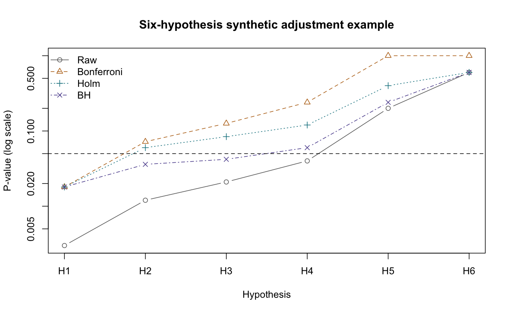

# Multiple Testing and Follow-Up Comparisons

::: {.cdi-message}
- **ID:** STATS-021
- **Type:** Statistical reasoning and method reference
- **Audience:** Beginner to intermediate learners, researchers, and analysts
- **Theme:** Define hypothesis families, choose an error-control goal, and report adjusted results without losing the estimates and uncertainty
:::

## 1. Your question

> How should we interpret evidence when several related hypotheses are tested?

A study may compare several groups, examine multiple outcomes, or screen many features. Looking at many p-values increases opportunities for false rejection. This chapter uses six **synthetic p-values** to explain adjustment. They are teaching inputs, not outputs from an underlying dataset or real study.

## 2. Define the family first

A testing family is the collection of hypotheses for which you intend a joint error-control claim. Define it using the scientific question, planned decisions, and analysis strategy before selecting favorable results.

| Example | Possible family |
|---|---|
| All pairs among three groups | Three pairwise comparisons |
| Several outcomes supporting one intervention claim | Prespecified outcome tests relevant to that claim |
| Feature discovery in an omics screen | The prespecified set of tested features |
| One primary question plus exploratory analyses | Explicit primary and exploratory strategies, with justified error handling |

Three groups produce $3(3-1)/2=3$ pairs; five groups produce ten. Separate files or separate software runs do not automatically make hypotheses separate families.

Do not adjust only the p-values below 0.05, or split a family after seeing results. Adjustments cannot recover unrecorded model searches, outcome switching, or selective reporting.

## 3. Choose the error-control goal

| Goal | Definition | Example method |
|---|---|---|
| Family-wise error rate (FWER) | Probability of one or more false rejections in the family | Bonferroni or Holm |
| False discovery rate (FDR) | Expected false-discovery proportion among rejections, taking that proportion as zero when there are no rejections | Benjamini–Hochberg under suitable dependence conditions |

FWER and FDR are different guarantees. FDR control at 5% does not mean every rejected hypothesis has a 5% probability of being false, nor that exactly 5% of a particular discovery list is false.

If 20 independent valid tests each have a 5% false-positive rate and all nulls are true, the chance of at least one false rejection is:

$$
1-(1-0.05)^{20}\approx0.642.
$$

The independence and all-null conditions matter; this calculation is not a universal false-discovery probability for every set of 20 tests.

## 4. Understand the adjustments

### Bonferroni

For m tests, compare each raw p-value with $\alpha/m$, or use adjusted p-values $\min(mp,1)$. With valid marginal p-values, it controls FWER under arbitrary dependence. It can be conservative.

### Holm

Order the p-values from smallest to largest. Compare them sequentially with $\alpha/(m-i+1)$, stopping at the first failure. Adjusted p-values use cumulative maxima of $(m-i+1)p_{(i)}$, capped at one, then return to the original order.

Holm controls FWER under arbitrary dependence when individual p-values are valid, and is never less powerful than ordinary Bonferroni for the same family.

### Benjamini–Hochberg (BH)

Order the p-values and find the largest rank i satisfying:

$$
p_{(i)}\leq\frac{i}{m}q.
$$

Reject that hypothesis and all with smaller ordered p-values. Adjusted values use reverse cumulative minima of $mp_{(i)}/i$, capped at one.

The usual FDR guarantee holds under independence and certain positive dependence conditions. Arbitrary dependence may require another procedure, such as Benjamini–Yekutieli, or a justified design-specific method. Do not assume that every correlated analysis meets BH's conditions.

## 5. Run the example

Copy the companion files into your repository root:

- [Synthetic p-values](data/example/21-example-p-values.csv)
- [Complete base R script](scripts/R/21-multiple-testing.R)

```bash
Rscript scripts/R/21-multiple-testing.R
```

Chapter code is non-executable display code; run the script separately.

```r
# All six hypotheses form the specified teaching family.
p <- c(0.003, 0.012, 0.021, 0.040, 0.200, 0.600)
p.adjust(p, method = "bonferroni")
p.adjust(p, method = "holm")
p.adjust(p, method = "BH")
```

The script exports `results/tables/21-adjusted-p-values.csv` and `results/figures/21-adjustments.png`. The plot uses a logarithmic p-value scale and a 0.05 reference line. Pre-generated R outputs are not included or needed for rendering.

{#fig-21-adjustments width=100%}

## 6. Verify and explain the output

| Hypothesis | Raw p | Bonferroni | Holm | BH |
|---|---:|---:|---:|---:|
| H1 | 0.003 | 0.018 | 0.018 | 0.018 |
| H2 | 0.012 | 0.072 | 0.060 | 0.036 |
| H3 | 0.021 | 0.126 | 0.084 | 0.042 |
| H4 | 0.040 | 0.240 | 0.120 | 0.060 |
| H5 | 0.200 | 1.000 | 0.400 | 0.240 |
| H6 | 0.600 | 1.000 | 0.600 | 0.600 |

At 0.05, the unadjusted procedure rejects four hypotheses. Bonferroni and Holm reject H1 only. BH rejects H1, H2, and H3, with a different error-control goal and additional dependence conditions.

For Holm, H2's adjusted value is $5\times0.012=0.060$, after applying the cumulative-maximum rule. For BH, H3's initial adjusted quantity is $6\times0.021/3=0.042$, and the reverse-minimum rule leaves it unchanged here.

These numbers illustrate procedures; they do not tell us which nulls are actually true. Do not choose BH merely because it produces more rejections after inspecting the results. Select the inferential goal first.

## 7. Connect adjustment to follow-up analysis

An omnibus ANOVA or Kruskal–Wallis result does not identify specific differing pairs. Use planned contrasts or an appropriate adjusted follow-up procedure. An omnibus rejection is not universal permission for unrestricted unadjusted comparisons.

Examples in earlier chapters include pairwise Welch tests with Holm adjustment, Tukey comparisons under a common-variance ANOVA model, and separate rank-sum tests with Holm adjustment. They use different assumptions and should be named accurately.

Prespecified contrasts can sometimes be tested without a preceding omnibus rejection under a valid planned strategy. Hierarchical or gatekeeping procedures need explicit rules; do not invent them after seeing p-values.

## 8. Confidence intervals and effect sizes

Adjusted p-values do not adjust estimates, repair bias, or make small effects practically important. Report the effect estimate in meaningful units and describe uncertainty.

Ordinary 95% intervals for each comparison are not automatically simultaneous 95% intervals for the family. Holm-adjusted p-values can therefore accompany ordinary intervals that appear inconsistent with threshold decisions. Label the intervals clearly.

Bonferroni simultaneous intervals can be constructed using per-comparison confidence level $1-\alpha/m$ when each interval has the required coverage. Tukey intervals supply a model-specific all-pairs simultaneous procedure. FDR-adjusted p-values do not automatically imply a corresponding set of ordinary intervals with a particular simultaneous coverage guarantee.

## 9. AI assistance and verification

> Treat all six supplied p-values as one family. Explain the distinction between FWER and FDR, calculate Bonferroni, Holm, and BH adjustments, and verify the table in original hypothesis order. State the validity and dependence conditions for each guarantee. Do not filter to significant raw p-values before adjustment, choose the method based on discoveries, or interpret BH values as individual probabilities of false hypotheses.

Verify the family size, adjustment method, original row mapping, and intended error-control level. If AI generates additional outcomes, subgroups, transformations, or models during exploration, record that search and reconsider the scope of the claims. Multiplicity includes analytical choices, not just the final printed table.

## 10. Report your strategy and findings

For an applied family of confirmatory comparisons:

> We prespecified the six hypotheses as one family and controlled the family-wise error rate at 0.05 using Holm's procedure. We report all raw and adjusted p-values alongside estimates and clearly labeled intervals. In the synthetic adjustment example, only H1 met the Holm-adjusted threshold (adjusted p=0.018).

For exploratory discovery using BH, state the FDR target, family definition, dependence justification, and adjustment method. Describe findings as discoveries requiring contextual evaluation and, where appropriate, further validation. Do not claim that a particular proportion of the observed list is certainly false.

## 11. Common mistakes

| Mistake | Better approach |
|---|---|
| Adjusting only favorable p-values | Include the full defined family |
| Changing families after seeing results | Prespecify and explain any justified revisions |
| Calling FDR control family-wise control | State the actual guarantee |
| Treating adjusted p as probability the null is true | Explain the procedure's repeated-sampling meaning |
| Ignoring selection across models and outcomes | Record exploratory searches and limit claims |
| Equating discovery with practical importance | Report magnitude, uncertainty, and context |

## 12. Check your understanding

An AI tool selects the four raw p-values below 0.05, applies BH to those four, and ignores H5 and H6.

What should change?

::: {.callout-note collapse="true"}
## Check your reasoning
The defined family contains six hypotheses. Selecting favorable values first changes the adjustment and invalidates the stated full-family guarantee. Apply the method to all six, retain their identities, and report the planned error-control goal and conditions.
:::

## Next step

Continue to [Sample Size and Power](22-sample-size.qmd) to plan studies around meaningful effects, precision, and the intended testing strategy.
