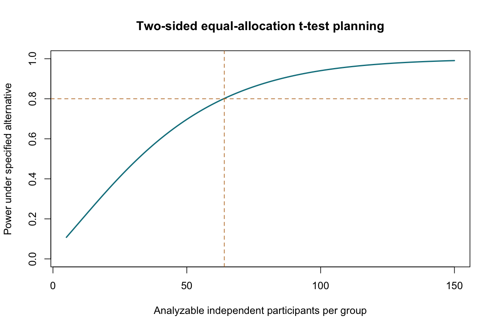

# Sample Size and Power

::: {.cdi-message}
- **ID:** STATS-022
- **Type:** Study planning reference
- **Audience:** Beginner to intermediate learners, researchers, and analysts
- **Theme:** Plan independent information around meaningful differences, uncertainty, and explicit design assumptions
:::

## 1. Your question

> How many learners should we plan for to detect a meaningful difference between two independent population mean scores?

Before collecting data, specify the target difference, variability, design, testing procedure, and acceptable uncertainty. A software-generated sample size is only as defensible as those inputs.

This teaching example plans a two-sided, equal-allocation two-sample t-test with a common population SD. It is not a universal sample-size recommendation for educational studies.

## 2. Define the planning inputs

| Input | Illustrative choice | Why it matters |
|---|---:|---|
| Outcome | Assessment score | Defines units and measurement |
| Meaningful mean difference | 5 points | Difference the study should be able to detect |
| Assumed common SD | 10 points | Determines noise relative to the target difference |
| Significance level | 0.05 | Type I error threshold for the planned test |
| Target power | 80% | Rejection probability at the specified alternative |
| Alternative | Two-sided | Allows differences in either direction |
| Allocation | Equal groups | Same planned analyzable count in each arm |
| Expected loss fraction | 15% | Illustrative recruitment allowance |

Five points and SD ten are hypothetical assumptions, not estimates established by this guide. Use subject knowledge, prior evidence, and justified sensitivity ranges for an applied plan. A pilot SD can be highly uncertain.

## 3. What power means

Power is the probability of rejecting the null hypothesis **if the specified alternative and model assumptions hold**. It depends on the true effect, variability, sample size, test, and design.

An 80% target does not mean an 80% probability that the alternative is true, that this particular study will succeed, or that a significant finding will be correct. It describes repeated-sampling performance at a chosen alternative.

With the same design and variability, more independent observations usually increase power. Smaller target differences, greater variability, stricter alpha levels, and higher desired power generally require larger samples.

## 4. Run the planning calculation

Copy the companion files into the repository root:

- [Illustrative planning assumptions](data/example/22-planning-assumptions.csv)
- [Complete base R script](scripts/R/22-sample-size.R)

```bash
Rscript scripts/R/22-sample-size.R
```

All chapter code blocks are non-executable. Run the standalone script separately.

```r
plan <- power.t.test(delta = 5, sd = 10, sig.level = 0.05,
                     power = 0.80, type = "two.sample",
                     alternative = "two.sided", strict = TRUE)
ceiling(plan$n)
```

For `type = "two.sample"`, n is **per group**, not the combined total. The function uses a common-variance t-test planning model. It does not directly calculate Welch power for arbitrary unequal variances or unequal allocation. Align the planning method with the intended analysis; use an appropriate extension or simulation when needed.

`strict = TRUE` includes rejection in both tails for the two-sided test. The script uses that setting consistently for planning and power verification.

{#fig-22-power-curve width=100%}

## 5. Verify and explain the result

The calculation requires approximately 63.77 analyzable learners per group, rounded up to **64 per group**, or 128 total, under the stated assumptions. The script recalculates power at the rounded integer sample size.

A rough large-sample check is:

$$
n\approx\frac{2\sigma^2(z_{1-\alpha/2}+z_{1-\beta})^2}{\Delta^2}.
$$

Substituting SD ten, difference five, alpha 0.05, and power 0.80 gives about 62.8 per group. The t-based result is slightly larger because it accounts for estimation of variance through the t distribution.

### Allow for expected losses

An illustrative allowance is:

$$
n_{\text{recruit}}=\left\lceil\frac{n_{\text{analyzable}}}{1-L}\right\rceil.
$$

At 15% expected loss, $\lceil64/0.85\rceil=76$ per group, or **152 recruits** total.

This is an expected retention allowance, not a guarantee of 64 analyzable learners. It does not correct bias from informative dropout. Recruitment feasibility, differential losses, and missing-data handling need separate consideration.

## 6. Examine sensitivity

The script recalculates required analyzable counts for assumed SDs of eight, ten, and twelve points. Inspect the exported sensitivity table instead of reporting a single count as certain.

Also consider plausible differences, target power levels, allocation ratios, and outcome quality. Do not choose an implausibly large effect or low variability merely to make the required sample affordable.

The power-curve figure shows power against analyzable participants per group for the fixed five-point, SD-ten model. It is conditional on those assumptions. It is not a probability forecast for an individual study.

The script generates `22-sample-size-plan.csv`, `22-sd-sensitivity.csv`, and `22-power-curve.csv` under `results/tables/`, plus `results/figures/22-power-curve.png`. Pre-generated R outputs are not included; generate the files before rendering this chapter.

## 7. Precision can be the primary goal

Some studies primarily estimate a quantity rather than test a null. Plan around an acceptable confidence-interval width when that better matches the goal.

For an independent mean with a known planning SD, a rough normal-approximation count for desired half-width h is:

$$
n\approx\left(\frac{z_{0.975}\sigma}{h}\right)^2.
$$

This is a one-mean formula, not a two-group formula. Unknown variance, small samples, and complex designs need appropriate refinements. For proportions, planning precision depends on the anticipated proportion and interval method.

Avoid treating failure to reject as evidence of equivalence. Equivalence or noninferiority questions require a justified margin and a matching design and analysis.

## 8. Match the sample size to the independent unit

| Design feature | Planning consequence |
|---|---|
| Learners within classrooms | Account for clustering and the number of classrooms |
| Paired measurements | Plan using variability of within-pair differences or an appropriate paired model |
| Repeated visits | Account for covariance, timing, and attrition |
| Several primary comparisons | Reflect the planned multiplicity strategy |
| Sparse binary outcomes | Ensure adequate event and non-event information for the intended model |

For equal-sized clusters, the familiar approximation $1+(m-1)ICC$ describes a design effect under a simple exchangeable correlation model. It is only a starting approximation; unequal cluster sizes, few clusters, allocation level, and degrees of freedom can materially change requirements.

Taking repeated measurements from the same participants does not produce the same information as recruiting that many independent participants. More rows cannot substitute automatically for more independent units.

## 9. Avoid retrospective observed power

Do not calculate post-hoc power using the observed effect and interpret low power as an explanation of a nonsignificant p-value. For a fixed test and sample, observed-effect power often repackages the p-value and adds little useful information.

After analysis, emphasize the effect estimate and confidence interval. For a future study, use defensible external assumptions and sensitivity analyses. If a sample size is fixed by feasibility, report detectable effects or precision under several scenarios rather than claiming the sample is adequate without a target.

Repeatedly collecting data and stopping when p < 0.05 also changes error rates. Sequential designs need prespecified monitoring and appropriate inferential procedures.

## 10. Use AI and check its suggestions

> Plan an equal-allocation independent two-sample mean comparison with a meaningful difference of five score points, common SD ten, two-sided alpha 0.05, and target power 0.80. Use the stated common-variance t-test model and explain that n is per group. Round up, check achieved power, and calculate an illustrative 15% loss allowance. State that these are hypothetical assumptions, ask about clustering and missingness, and distinguish this model from unequal-variance Welch planning.

Verify units, independent unit, per-group versus total counts, rounding direction, loss denominator, and analysis compatibility. Ask for sensitivity calculations rather than a single unexplained number.

## 11. Report the plan

> Under an equal-allocation independent two-sample t-test planning model, detecting a five-point mean difference with common SD ten, two-sided alpha 0.05, and 80% power required 64 analyzable learners per group. An illustrative 15% loss allowance increased recruitment to 76 per group, or 152 total. These hypothetical inputs require substantive justification and sensitivity assessment before applied use; clustering and informative dropout are not addressed by this calculation.

An applied plan should identify evidence for every important input, the planned analysis, allocation, multiplicity handling, sensitivity range, feasibility, and reproducible software settings.

## 12. Check your understanding

An AI response says: “We need 64 learners total because `power.t.test()` returned n near 64.”

What should change?

::: {.callout-note collapse="true"}
## Check your reasoning
For this two-sample calculation, n is per group. Round up to 64 analyzable learners in each group, giving 128 total before the illustrative loss allowance. Confirm the function's model and the independent unit before using the count.
:::

## Next step

Continue to [Reporting Statistical Findings](23-reporting.qmd) to connect estimates, uncertainty, methods, and limitations in a clear report.
